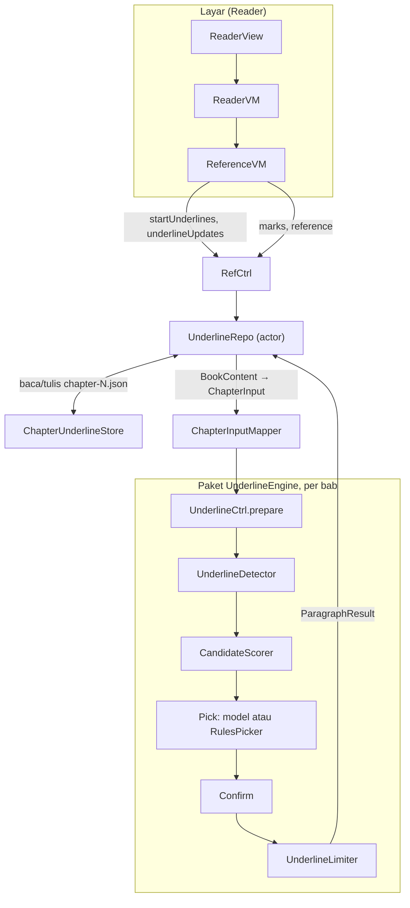
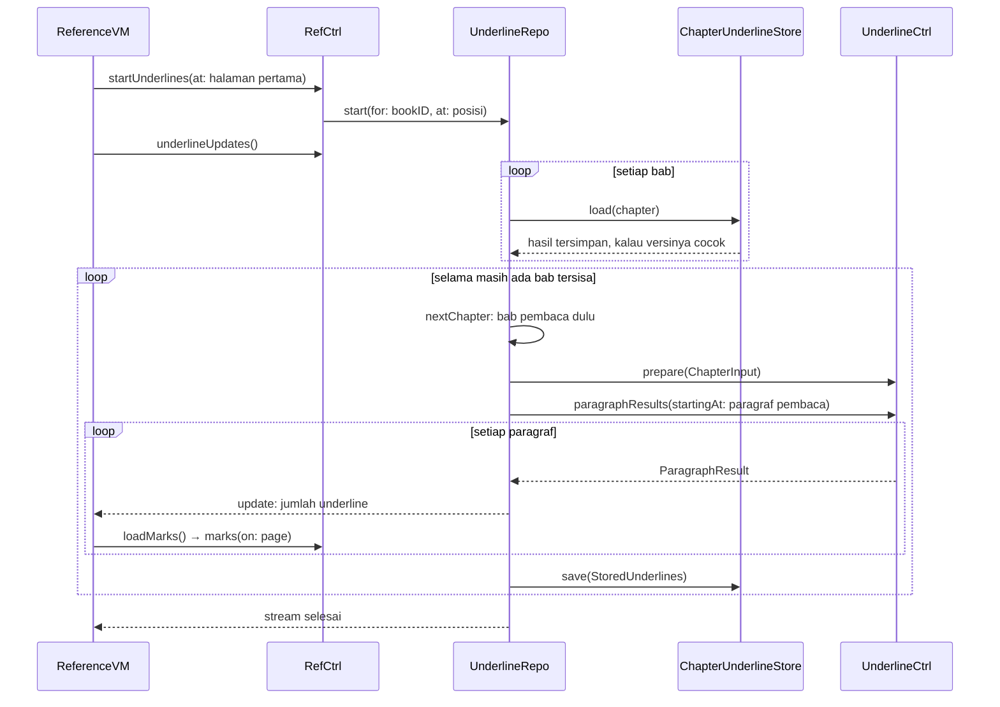

# Walkthrough: alur data UnderlineEngine (branch `Underline-Engine`)

Dokumen ini mengikuti **data** dari saat pembaca membuka buku sampai garis bawah muncul di halaman dan kartu "Earlier Passage" terbuka saat diketuk. Setiap pemberhentian berisi empat hal:

- **Masuk**: data yang diterima
- **Fungsi**: file dan fungsi yang mengolahnya
- **Keluar**: data yang dihasilkan
- **Knob**: nilai yang bisa diubah untuk menala langkah itu

Untuk siapa: engineer yang akan menala engine. Tidak perlu bisa menulis Swift. Cukup tahu bahwa `struct`/`enum` adalah tipe data, `func` adalah fungsi, `async` berarti fungsinya bisa menunggu, dan `actor` berarti hanya satu pemanggil yang mengubah isinya pada satu waktu.

Flowchart ditulis dengan Mermaid. GitHub menampilkannya sebagai gambar; di Xcode terlihat sebagai teks.

Ada dua repo. Path yang diawali `App/` ada di repo ini. Path lain (`Pipeline/`, `1-Preprocessing/`, `2-Model/`, `3-Postprocessing/`, `Shared/`) relatif terhadap `Sources/UnderlineEngine/` di repo [AftrHours/UnderlineEngine](https://github.com/AftrHours/UnderlineEngine).

Dokumen ini mengikuti engine di commit `2e39666` (ujung branch `Underline-Engine` di remote). Keputusan integrasi ada di `docs/superpowers/specs/2026-11-03-underline-engine-integration.md`.

## Contoh yang dipakai di seluruh dokumen

**Little Women, Bab 1.** Dua kalimat ini diikuti di setiap pemberhentian:

> **s23**: And Beth looked at her rough hands with a sigh that any one could hear that time.
>
> **s39**: Jo immediately sat up, put her hands in her pockets, and began to whistle.

Hasil nyatanya, dari `Eval/compare/chapter1-underlines.csv` di repo engine (saat ini belum di-push):

| Frasa | Referensi yang benar (golden set) | Hasil Mac | Hasil iPad |
|---|---|---|---|
| "looked at her rough hands with a sigh that any one could hear that time" (s23) | s21, s22: Beth mencuci piring dan merapikan rumah | s14, **salah** menurut juri | s14 |
| "immediately sat up" (s39) | s37, s38: teguran Amy | Dibuang (`confirmRejected`) | s38 |
| "began to whistle" (s39) | s37, s38: jawaban Jo karena disebut tidak sopan | s13, **salah** menurut juri | Tidak digarisbawahi |

Nomor kalimat di sini dihitung dari awal file `Dataset/little-women-ch1.txt`. Di aplikasi nomornya global, dihitung dari awal buku. CSV itu tidak mencatat commit dan nilai knob yang dipakai, jadi anggap sebagai gambaran, bukan patokan. Golden set juga masih provisional.

## Gambaran besar

Engine mencari frasa yang mungkin tidak diikuti pembaca yang membaca sekilas, lalu menggarisbawahinya **hanya jika** bisa menunjuk kalimat penulis sendiri yang lebih awal dan menjelaskannya. Engine tidak pernah menulis penjelasan, tidak pernah memakai teks di kalimat itu atau sesudahnya, dan tidak tahu siapa tokohnya.



Satu bab dari awal sampai tersimpan:



## Tipe data yang lewat

| Tipe | Isi | File |
|---|---|---|
| `BookContent` | Seluruh buku: bab, paragraf, kalimat, versi parser | `App/Book/Models/BookContent.swift` |
| `ChapterInput` | Satu bab dalam bentuk yang diterima engine. Nomor paragraf dan kalimat tetap global | `Shared/Models/InputModels.swift` |
| `IndexedSentence`, `IndexedChapter` | Kalimat yang sudah disiapkan: teks, label kata, nama, event, vektor makna | `Shared/Models/IndexedChapter.swift` |
| `EventPhrase` | Satu frasa calon: teks, posisi di kalimat, `EventRole`, `Track`. Nama punya `role` kosong | `Shared/Models/EventModels.swift` |
| `UnderlineCandidate` | Satu frasa yang lolos deteksi, belum dicari referensinya | `1-Preprocessing/UnderlineDetector.swift` |
| `SearchQuery`, `Candidate`, `SearchResult` | Yang dicari dan kalimat yang sudah diberi skor | `Shared/Models/Candidate.swift` |
| `Underline`, `AnswerPassage` | **Hasil akhir**: frasa, posisinya di paragraf, jenisnya, kalimat referensi, dan penentunya (`model` atau `rules`) | `Shared/Models/UnderlineModels.swift`, `PassageModels.swift` |
| `UnderlineRecord`, `DropReason` | Catatan tiap frasa yang dipertimbangkan, disimpan atau dibuang, beserta alasannya. Berisi teks buku, jadi hanya untuk log lokal | `Shared/Models/UnderlineRecord.swift` |
| `ParagraphResult` | Satu paragraf selesai: underline dan semua catatannya | `Shared/Models/UnderlineRecord.swift` |
| `DroppedPhrase` | Bentuk ringkas frasa yang dibuang, milik aplikasi | `App/Analysis/Models/DroppedPhrase.swift` |
| `StoredUnderlines` | **Hasil satu bab yang disimpan**: versi, underline, frasa yang dibuang | `App/Analysis/Repo/ChapterUnderlineStore.swift` |
| `UnderlineProgress` | Progres per buku, untuk layar debug | `App/Analysis/Models/UnderlineProgress.swift` |
| `Mark` | Satu tanda di satu halaman: garis bawah atau sorotan | `App/Analysis/Models/Mark.swift` |
| `UnderlineReference`, `ContextPassage` | Isi kartu saat diketuk: frasa dan kalimat referensi | `App/Analysis/Models/` |

Tiga hal penting tentang posisi:

- **Nomor paragraf dan kalimat selalu global**, dihitung dari awal buku. `SentenceSplitter` memecah kalimat persis seperti `EPUBParseSvc.sentenceRanges`. Kalau parser aplikasi berubah, splitter engine harus ikut diubah.
- **Posisi frasa ada dua macam.** `EventPhrase.range` dihitung dari awal kalimat, `Underline.range` dari awal paragraf. `UnderlineGuard.paragraphRange` yang menerjemahkan. `RefCtrl.pageRange` lalu menerjemahkannya ke posisi di halaman.
- **Anti-spoiler ada di satu tempat.** Semua kalimat yang boleh dipakai langkah mana pun datang dari `ReadBoundary.searchable(before:first:last:)`, yaitu kalimat dari awal bab sampai tepat sebelum kalimat frasa.

---

## 1. Halaman pertama tampil, engine dimulai

**Masuk:** halaman pertama yang tampil (`Page`).

**Fungsi** (`App/Reader/VM/ReferenceVM.swift`):

- `update(shownPage:loadedPages:)` dipanggil `ReaderVM` setiap halaman berganti. Halaman pertama memanggil `followUnderlines`. Pindah bab memanggil `RefCtrl.focusUnderlines`.
- `followUnderlines` memanggil `RefCtrl.startUnderlines(at:)`, lalu memuat ulang tanda setiap ada kabar dari `RefCtrl.underlineUpdates`.

Engine menunggu halaman pertama supaya tahu bab mana yang dikerjakan lebih dulu.

**Kapan berhenti:** `ReferenceVM.appBackgrounded` menghentikan engine, dan `appForegrounded` memulainya lagi. Tombol kembali ke perpustakaan **tidak** menghentikannya: engine terus bekerja sampai aplikasi ke background atau buku lain dibuka. Membuka buku lain menghentikan yang lama, di dalam `UnderlineRepo.start`.

**Keluar:** satu pekerjaan latar belakang per buku, dan `UnderlineRepo.focus` berisi posisi pembaca.

**Knob:** tidak ada.

## 2. UnderlineRepo: urutan bab, simpan, lanjutkan

**Masuk:** `bookID` dan posisi pembaca.

**Fungsi** (`App/Analysis/Repo/UnderlineRepo.swift`, `run`):

1. Muat `BookContent` dan buat `UnderlineCtrl`. Di sini engine memutuskan memakai model atau aturan saja (`usesModel`).
2. Baca hasil tersimpan semua bab. Yang cocok langsung masuk ke memori dan ditandai selesai.
3. `nextChapter` memilih bab berikutnya: bab pembaca kalau belum selesai, kalau tidak bab berikutnya dalam urutan baca, lalu kembali ke awal. Bab yang sedang berjalan tidak disela, karena hasilnya akan hilang.
4. `waitWhileHot` menunggu selama perangkat panas (`serious` atau `critical`) atau dalam Low Power Mode.
5. `startSentence` memilih titik mulai: paragraf pembaca kalau ia ada di bab ini, kalau tidak awal bab.
6. Terima `ParagraphResult` dari `paragraphResults`. Setiap paragraf langsung ditambahkan ke `found` dan listener diberi kabar, jadi garis bawah muncul sambil berjalan.
7. Kalau bab hasilnya kosong padahal memakai model, tanya `ModelCheckSvc.modelAnswers`. Kalau model tidak menjawab, berhenti tanpa menyimpan (`modelNotAnswering`). Alasannya: `availability` bisa bilang ya sementara semua panggilan gagal, dan itu terlihat seperti bab yang memang tidak punya garis bawah.
8. Simpan lewat `ChapterUnderlineStore.save`. Bab yang terhenti di tengah tidak pernah disimpan, jadi diulang dari awal.

Semua bab diproses tanpa penyaring, termasuk halaman pembuka dan lisensi di akhir buku.

**Keluar:** `Books/<id>/underlines/chapter-N.json`, dan `found` di memori.

**Hasil tersimpan dipakai ulang** hanya jika `engineVersion`, `parserVersion`, dan `usedModel` semuanya sama (`ChapterUnderlineStore.load`).

**Knob** (`UnderlineRepoKnobs`):

| Knob | Nilai | Efek |
|---|---|---|
| `engineVersion` | 2 | Naikkan setiap hasil engine berubah, supaya bab tersimpan dihitung ulang |
| `throttlePause` | 30 detik | Jeda sebelum memeriksa ulang suhu dan Low Power Mode |

## 3. BookContent → ChapterInput

**Masuk:** `BookContent` dan nomor bab.

**Fungsi:** `ChapterInputMapper.input(chapter:in:)` (`App/Analysis/Rules/ChapterInputMapper.swift`) mengambil teks tiap paragraf dan kalimat milik bab itu. Nomornya tidak diubah.

**Keluar:** `ChapterInput`.

**Knob:** tidak ada.

## 4. Prepare: label kata, event, vektor

**Masuk:** `ChapterInput`.

**Fungsi:** `UnderlineCtrl.prepare` → `ChapterIndexSvc.prepare` (`1-Preprocessing/ChapterIndexSvc+Prepare.swift`). Untuk tiap kalimat:

- **Label kata** (`ChapterIndexSvc.index`): lemma, jenis kata, dan nama lewat `NLTagger`. Tanpa model bahasa Inggris (Simulator), dipakai aturan sederhana: kata berhuruf besar yang bukan di awal kalimat dianggap nama orang.
- **Event** (`EventSplitter.events`): kalimat dipotong di koma, titik koma, tanda kutip, dan "and/but/or". Tiap potongan yang punya kata kerja menjadi satu event. Potongan tanpa kata kerja digabung ke event sebelumnya. Kata seperti "said Jo" di luar kutipan dianggap penanda ucapan, bukan event.
- **Peran dan jalur** (`EventRoles.role`, `track`): tiap event diberi `EventRole` (setting, initiatingEvent, internalResponse, goal, attempt, reaction, outcome) dan `Track` (character, goal, cause, time, place).
- **Vektor makna** (`EmbeddingSvcApple.vector`): `NLEmbedding` kalimat. Kalau tidak ada, rata-rata vektor kata. Kalau itu pun tidak ada, pencarian hanya memakai kata.

**Contoh, s39.** Dipotong di koma dan "and" menjadi tiga event: "immediately sat up", "put her hands in her pockets", dan "began to whistle". "immediately" adalah `reactionCues`, jadi event pertama berperan `reaction`.

**Keluar:** `IndexedChapter`.

**Knob:** `EventKnobs` (`1-Preprocessing/EventSplitter.swift`): `speechVerbs`, `reactionCues`, `emotionWords`, `wantVerbs`, `resultVerbs`, `stateVerbs`, `placeWords`, `timeWords`. `TaggingKnobs.notNames` untuk aturan cadangan.

## 5. Detect: frasa mana yang layak dicek

**Masuk:** satu `IndexedSentence` dan nama orang yang muncul di 20 kalimat sebelumnya (`UnderlineCtrl.recentNames`).

**Fungsi:** `UnderlineDetector.candidates` (`1-Preprocessing/UnderlineDetector.swift`). Event dibuang kalau:

- kurang dari `minPhraseWords` kata
- semua katanya kata umum (`isGeneral`)
- berjalur `cause` atau `goal` dan alasannya ada di kalimat yang sama ("…because…", lihat `EventRoles.reasonClause`)

Nama orang ikut menjadi calon kalau belum disebut di 20 kalimat terakhir.

Jenis (`UnderlineKind.of`): `reaction` → reaction, `internalResponse` → feeling, `outcome` → outcome, `attempt`/`goal`/`initiatingEvent` → action, `setting` → place atau thing, nama → person.

**Contoh, s23.** Frasanya panjang ("looked at her rough hands with a sigh that any one could hear that time") karena event berjalan sampai akhir potongan. Tidak ada koma yang memotongnya.

**Keluar:** `[UnderlineCandidate]`.

**Knob** (`UnderlineKnobs`): `minPhraseWords` (2), `generalWords`, `nameGapSentences` (20).

## 6. Search: memberi skor kalimat sebelumnya

**Masuk:** satu calon dan `IndexedChapter`.

**Fungsi:** `SearchQuery.make`, `CandidateScorer.rank`, `UnderlineSearch.candidates` (`2-Model/CandidateScorer.swift`).

Hanya kalimat **di bab yang sama** yang dicari, jadi frasa di awal bab sering tidak punya kandidat. Untuk nama orang, kumpulan kalimat dibatasi pada yang menyebut nama itu. Tiap kalimat dinilai:

```
rawMeaning = (1 + cosinus vektor frasa dan kalimat) / 2
rawWords   = lemma yang sama / jumlah lemma frasa
rawScore   = 0.65 × rawMeaning + 0.35 × rawWords     (penentu lolos atau tidak)
score      = 0.65 × meaning + 0.35 × words + bonus   (penentu urutan)
```

`meaning` dan `words` adalah versi yang diskalakan ke 0…1 dalam satu pencarian. Bonus:

- `trackHintBonus` kalau kalimat memuat kata yang cocok dengan jalurnya
- `roleLinkBonus` kalau kalimat punya event dengan peran yang biasanya menjawab peran frasa, misalnya `attempt` dijawab `goal` atau `initiatingEvent`. Untuk `reaction`: kalimat tepat sebelumnya
- `causeNear / (1 + jarak)` untuk jalur `cause`, dan `reactionNear / (1 + jarak)` kalau frasa memuat kata seperti "immediately"

Yang lanjut adalah `maxCandidates` teratas dengan `rawScore` minimal `minRawScore`. Kalau tidak ada, frasa dibuang (`noCandidate`).

**Catatan:** ambang ini hampir tidak menyaring. Kalimat yang maknanya tidak berhubungan (cosinus 0) sudah punya `rawMeaning` 0.5, jadi `rawScore`-nya 0.325. Cosinus 0.1 saja sudah melewati ambang 0.35.

**Keluar:** `SearchResult` dan daftar `Candidate`.

**Knob** (`SearchKnobs`):

| Knob | Nilai |
|---|---|
| `maxCandidates` | 6 |
| `minRawScore` | embed 0.425, words 0.25, both 0.35 |
| `embedWeight`, `wordsWeight` | 0.65, 0.35 (jaga `embedWeight` lebih besar) |
| `trackHintBonus`, `roleLinkBonus` | 0.10, 0.10 |
| `causeNear`, `reactionNear` | 0.15, 0.30 |
| `stopLemmas`, `goalWords`, `roleLinks` | Daftar kata dan pasangan peran |

## 7. Pick: memilih satu kalimat

**Masuk:** frasa, kalimatnya, dan kandidat.

**Fungsi:** `UnderlineCtrl.modelPath` (`Pipeline/UnderlineCtrl+Evaluate.swift`), `PromptBuilder.pick`, `UnderlineModelSvcFoundation.pick`.

Model menerima kalimat, frasa, petunjuk peran, dan kandidat bernomor (tiap kandidat dipotong sampai 40 kata). Jawabannya dipaksa berbentuk `GenPick`: **kutipan dulu, baru nomor**, jadi model memilih setelah mengutip. Nomor 0 berarti tidak ada.

Jumlah kandidat dipangkas agar muat (`TokenBudget`). Kalau konteks tetap meluap, jumlahnya dibagi dua dan dicoba sekali lagi, lalu pindah ke jalur aturan. Kegagalan lain membuang frasa (`modelFailed`), tanpa jalur aturan, karena ketepatan didahulukan.

Jawaban lalu diperiksa `UnderlineGuard.checkPick`: nomor harus ada, kalimatnya harus lebih awal, dan kutipan harus benar-benar ada di kalimat itu. Kalau gagal: `guardRejected`. Kalau nomor 0: `pickedNone`.

Terakhir, `UnderlineGuard.isInSameParagraph`: kalau kalimat terpilih ada di paragraf yang sama, frasa dibuang (`explainedInParagraph`), karena pembaca baru saja membacanya. Frasa itu tidak diberi kesempatan kedua dengan kandidat lain.

**Jalur aturan** (tanpa model): `RulesPicker.decide` memilih kandidat teratas kalau skornya cukup tinggi dan cukup unggul dari kandidat kedua.

**Contoh, s23.** Model memilih s14 ("I planned to spend mine in new music," said Beth, with a little sigh…). Keduanya memuat Beth dan "sigh", tapi s14 tidak menjelaskan tangan yang kasar. Definisi "explains" di prompt sebenarnya melarang ini: kalimat yang hanya memakai kata serupa tidak dihitung sebagai penjelasan.

**Keluar:** satu nomor kalimat, atau alasan dibuang.

**Knob:** `ModelKnobs` (`2-Model/UnderlineModelSvcFoundation.swift`): `definition`, `basePick`, `candidateWords` (40), `options` (greedy). `PromptBuilder.roleHint`. `JudgeKnobs` (`2-Model/RulesPicker.swift`): `minScore` (embed 0.85, words 0.50, both 0.70), `margin` (embed 0.03, words 0.15, both 0.05). `TokenBudget`: `outputReserve` (32), `marginFraction` (0.10).

## 8. Confirm: pendapat kedua

**Masuk:** frasa, kalimatnya, dan satu kalimat terpilih.

**Fungsi:** `UnderlineModelSvcFoundation.confirm`, dengan sesi model baru. Model hanya melihat satu kalimat itu, bukan kandidat lain, lalu menjawab `GenConfirm`: bukti dulu, baru ya atau tidak. Pick dan confirm harus setuju. Kalau tidak: `confirmRejected`. Kalau panggilannya gagal: `modelFailed`.

**Jalur aturan:** `RulesPicker.confirm` menerima kalau referensi punya kata isi yang sama, nama orang yang sama, atau event dengan peran yang biasanya menjawab peran frasa.

Setelah itu `UnderlineGuard.paragraphRange` memastikan teks di posisi frasa memang frasa itu, dan menerjemahkan posisinya ke paragraf.

**Contoh, s39, "immediately sat up".** Di Mac ditolak di sini (`confirmRejected`). Di iPad lolos dengan s38, yang benar.

**Keluar:** `Underline` dan `UnderlineRecord`.

**Knob:** `ModelKnobs.baseConfirm`, `definition`.

## 9. Limit: paling banyak dua per paragraf

**Masuk:** semua underline yang lolos dalam satu paragraf.

**Fungsi:** `UnderlineLimiter.apply` (`3-Postprocessing/UnderlineLimiter.swift`), dipanggil dari `UnderlineCtrl.limit`. Diurutkan dari `rawScore` tertinggi. Frasa yang bertumpuk di kalimat yang sama, atau yang melebihi batas, dibuang (`densityLimit`). Kalau skornya sama, yang didahulukan: kalimat lebih awal, frasa lebih awal, lalu urutan `kindOrder`.

**Contoh, s39.** Tiga event ada di satu kalimat. Maksimal dua yang tampil, dan paragrafnya tidak boleh punya garis bawah lain di luar itu.

**Keluar:** `ParagraphResult`.

**Knob** (`UnderlineKnobs`): `maxPerParagraph` (2), `kindOrder` (reaction, action, feeling, outcome, place, thing, person).

## 10. Underline → tanda per halaman

**Masuk:** `Page` yang sedang dimuat dan semua underline di memori.

**Fungsi:** `ReferenceVM.loadMarks` → `RefCtrl.marks(on:highlighting:)` (`App/Analysis/Ctrl/RefCtrl.swift`). `pageRange` menerjemahkan posisi di paragraf ke posisi di halaman, dan memotongnya kalau frasa melewati batas halaman. Dipanggil saat halaman berganti dan setiap ada kabar dari engine.

**Keluar:** `[Mark]`. `.underline(id:)` untuk garis bawah, `.highlight` untuk sorotan kalimat referensi dan hasil pencarian. `id` berbentuk `"nomorKalimat:posisiDiParagraf"`.

**Knob:** tidak ada.

## 11. Tanda → layar, kartu, lompat, kembali

**Tampilan:** `App/Reader/Views/PageTextView+iOS.swift` menggambar garis bawah titik-titik dan sorotan kuning.

**Ketuk garis bawah:** `ReferenceVM.markTapped` → `RefCtrl.reference(forUnderline:)` → `RefCardView`. Kartu menampilkan judul "Earlier Passage", frasa, lokasi ("judul bab • Page n"), kutipan, dan tombol Jump to Passage. Tidak ada nama tokoh.

**Lompat:** `jumpToPassageTapped` menyimpan posisi sekarang lewat `ReaderStateCtrl.saveReturnPosition`, lalu `onShowPage` membuka halaman kalimat referensi dengan sorotan.

**Kembali:** `returnToReadingTapped` membaca posisi tadi, membuka halamannya, dan menampilkan toast selama 2 detik.

---

## Alasan frasa dibuang

| `DropReason` | Terjadi di | Artinya |
|---|---|---|
| `noCandidate` | Pemberhentian 6 | Tidak ada kalimat sebelumnya yang skornya cukup |
| `pickedNone` | Pemberhentian 7 | Model menjawab 0, atau aturan tidak memilih |
| `guardRejected` | Pemberhentian 7, 8 | Nomor tidak ada, kalimat tidak lebih awal, kutipan tidak ada di kalimat itu, atau posisi frasa tidak cocok |
| `explainedInParagraph` | Pemberhentian 7 | Kalimat terpilih ada di paragraf yang sama |
| `confirmRejected` | Pemberhentian 8 | Confirm bilang kalimat itu tidak menjelaskan |
| `modelFailed` | Pemberhentian 7, 8 | Panggilan model gagal, bukan karena konteks meluap |
| `densityLimit` | Pemberhentian 9 | Melebihi batas paragraf atau bertumpuk |

## Layar debug

`App/Analysis/Debug/` hanya ada di build DEBUG. Dibuka dengan tombol ladybug di halaman baca. Saat engine berjalan, tombol itu menampilkan indikator putar. Datanya dari `RefCtrl.debugReport`, diperbarui tiap detik. Dua tab:

- **This Chapter**: bab yang sedang dibaca
- **Whole Book**: semua bab

Keduanya menampilkan status (bagian **Run**: status, jalur model atau aturan, bab selesai, jumlah garis bawah, jumlah frasa dibuang), kalimat yang digarisbawahi beserta referensinya, dan frasa yang dibuang per alasan.

Simulator tidak bisa dipakai untuk menilai fitur ini, karena panggilan modelnya gagal dan tidak menemukan event. Pakai iPad.

## Titik awal tuning

| Masalah | Terjadi di | Knob atau tempat yang terkait |
|---|---|---|
| 7 dari 10 referensi yang tampil salah (golden set yang belum direview) | Pemberhentian 6 sampai 8 | `ModelKnobs.definition`, `basePick`, `baseConfirm`, `SearchKnobs` |
| Referensi tampaknya dipilih karena kata yang mirip, seperti s23 → s14 yang sama-sama memuat "sigh" | Pemberhentian 6, 7 | `wordsWeight`, `ModelKnobs.definition` |
| Ambang kandidat hampir tidak menyaring | Pemberhentian 6 | `minRawScore`. Skala `rawMeaning` mulai dari 0.5 untuk cosinus 0 |
| Di Mac, confirm paling banyak membuang frasa: dari 155 baris CSV, 71 `confirmRejected`, 17 `guardRejected`, 3 `pickedNone`, 3 `modelFailed`, 1 `densityLimit`, 60 tampil | Pemberhentian 7, 8 | `ModelKnobs.baseConfirm`, `basePick` |
| iPad menampilkan 121 garis bawah, Mac 60, dari bab yang sama. Penyebabnya belum diteliti | Belum diketahui | Bandingkan kolom `mac_*` dan `ipad_*` di CSV |
| Frasa terlalu panjang, seperti s23 | Pemberhentian 4 | `EventSplitter.chunks`, `EventKnobs.boundaryCharacters`, `coordinators` |
| Frasa di awal bab tidak punya referensi | Pemberhentian 6 | Pencarian lintas bab belum ada, sengaja tidak masuk fase ini |
| Referensi terbaik ada di paragraf yang sama, sehingga frasa langsung dibuang | Pemberhentian 7 | `UnderlineCtrl.modelPath`: belum mencoba kandidat lain |
| Panggilan model gagal sesaat, frasa tetap hilang di bab yang sudah tersimpan | Pemberhentian 2, 7 | Terbawa sampai `engineVersion` naik |
| Halaman lisensi ikut diproses | Pemberhentian 2 | `UnderlineRepo.run`: belum ada penyaring bab |

**Setelah mengubah knob, naikkan `UnderlineRepoKnobs.engineVersion`**, supaya hasil bab yang tersimpan dihitung ulang.

**Perubahan lokal di repo engine tidak masuk ke aplikasi.** `project.yml` menunjuk ke branch `Underline-Engine` di GitHub. Perubahan harus di-push dulu, lalu paket diperbarui di Xcode (File → Packages → Update to Latest Package Versions). Commit yang dipakai terkunci di `Package.resolved`, dan file itu tidak ikut git karena ada di dalam `iRead.xcodeproj`. Jadi dua komputer bisa memakai commit engine yang berbeda.

**Cara melihat efek perubahan:** buka layar debug di iPad, atau jalankan harness di repo engine:

```
UNDERLINE_EVALS=1 swift test --filter goldenEvaluation          # golden set, jalur model
UNDERLINE_EVALS=1 swift test --filter rulesBaselineEvaluation   # golden set, jalur aturan
UNDERLINE_EVALS=1 UNDERLINE_SWEEP=1 swift test --filter sweepEvaluation   # semua frasa di bab
```

Hasilnya masuk ke `Eval/results/`, termasuk CSV per frasa. Baca **mismatch rate** dulu: dari garis bawah yang tampil, berapa yang menunjuk kalimat yang salah.
