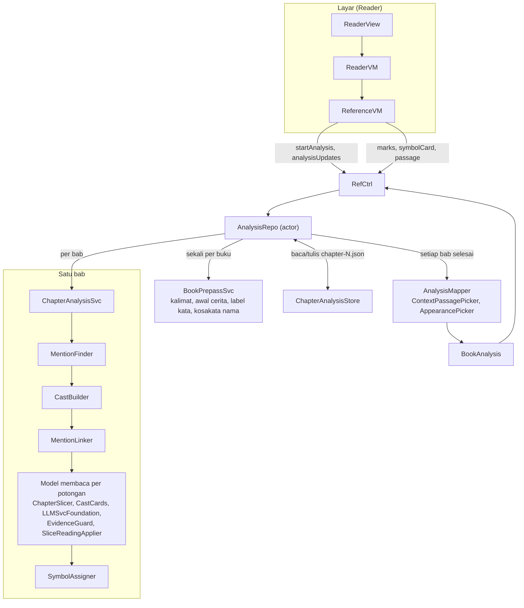
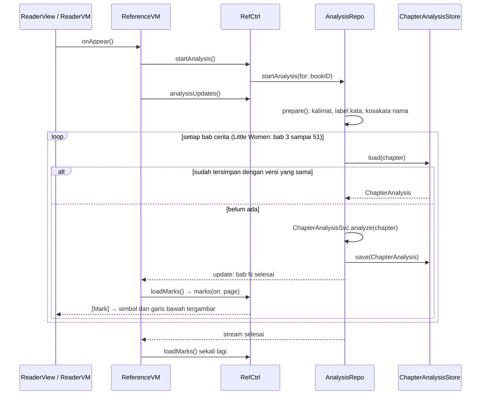
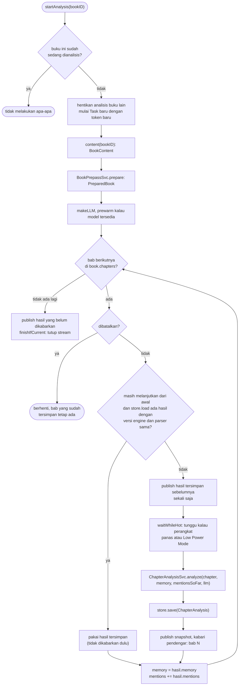
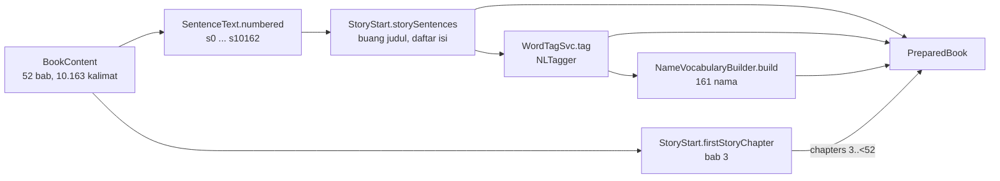
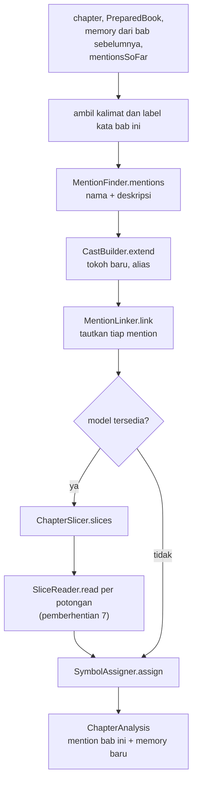
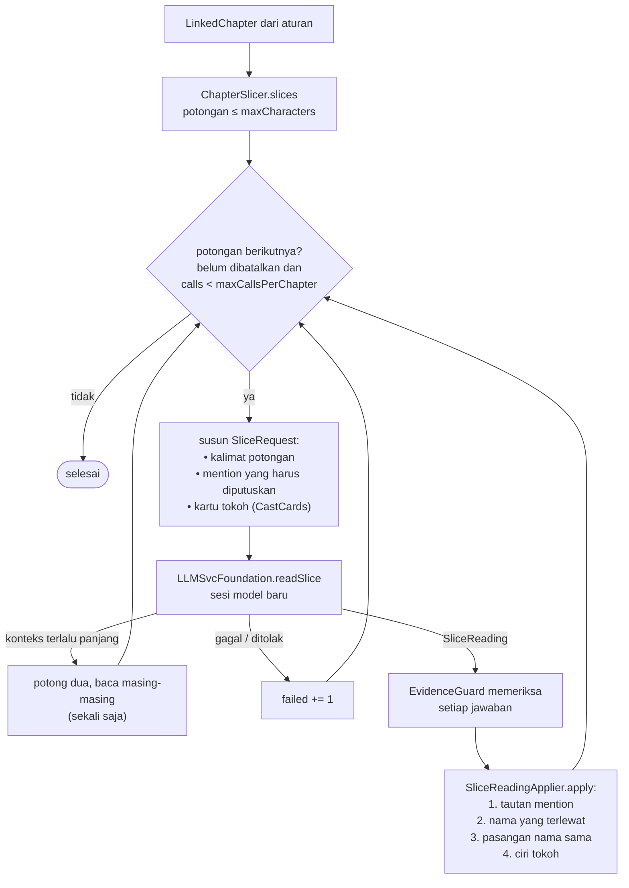

# Walkthrough: alur data engine tokoh (branch `Feature-tune`)

Dokumen ini mengikuti **data** dari saat pembaca membuka buku sampai simbol, garis bawah, dan kartu tokoh muncul di halaman. Setiap pemberhentian berisi empat hal:

- **Masuk**: data yang diterima, dengan contoh nyata
- **Fungsi**: file dan fungsi yang mengolahnya, termasuk fungsi `private`
- **Keluar**: data yang dihasilkan, dengan contoh nyata
- **Knob**: nilai yang bisa diubah untuk menala langkah itu

Untuk siapa: engineer yang akan menala engine. Tidak perlu bisa menulis Swift. Cukup tahu bahwa `struct`/`enum` adalah tipe data, `func` adalah fungsi, `async` berarti fungsinya bisa menunggu, `actor` berarti hanya satu pemanggil yang mengubah isinya pada satu waktu, dan `private` berarti fungsi itu hanya dipakai di dalam file-nya.

Flowchart di dokumen ini ditulis dengan Mermaid. GitHub menampilkannya sebagai gambar; di Xcode terlihat sebagai teks.

Semua path file relatif terhadap folder `App/`.

## Contoh yang dipakai di seluruh dokumen

**Little Women, Bab 1 ("CHAPTER ONE PLAYING PILGRIMS"), kalimat s65 sampai s293.** Di bagian tengahnya keempat saudari diperkenalkan:

> **s136**: Margaret, the eldest of the four, was sixteen, and very pretty, being plump and fair, with large eyes, plenty of soft brown hair, …
>
> **s141**: Elizabeth, or Beth, as everyone called her, was a rosy, smooth-haired, bright-eyed girl of thirteen, with a shy manner, a timid voice, …
>
> **s143**: Amy, though the youngest, was a most important person, in her own opinion at least.
>
> **s144**: A regular snow maiden, with blue eyes, and yellow hair curling on her shoulders, pale and slender, …

Pembaca manusia tahu tiga hal: Margaret adalah Meg, deskripsi s141 adalah Beth, dan "snow maiden" di s144 adalah **Amy**. Kasus-kasus ini diikuti di setiap pemberhentian, supaya terlihat langkah mana yang benar dan mana yang salah.

Angka berasal dari menjalankan engine di Mac (model bahasa Inggris NaturalLanguage dan Apple Intelligence aktif, konteks model 8192 token), dengan kode `Feature-tune` di commit `2e91e97` ditambah perubahan kartu penampilan (`AppearancePicker`). Di iPad hasilnya seharusnya sama. Simulator berbeda jauh, karena Simulator tidak punya model bahasa Inggris dan tidak punya Apple Intelligence.

## Gambaran besar

Engine membaca buku **bab demi bab**, seperti pembaca manusia. Ia membawa **ingatan tokoh** (`CastMemory`) dari satu bab ke bab berikutnya. Setiap bab diolah dua lapis: aturan dulu (NaturalLanguage dan Swift biasa, cepat), lalu Foundation Models membaca bab itu per potongan dan membetulkan hasil aturan. Hasil tiap bab disimpan di perangkat, jadi buku yang sama tidak perlu dianalisis ulang.



Urutan waktunya, dari buku dibuka sampai tanda muncul:



## Tipe data yang lewat

| Tipe | Isi | File |
|---|---|---|
| `BookContent` | Seluruh buku: bab, paragraf, kalimat. Hasil parser EPUB, tidak pernah diubah engine | `Book/Models/BookContent.swift` |
| `Sentence` | Satu kalimat: nomor paragraf dan rentang huruf di dalam paragraf | `Book/Models/Sentence.swift` |
| `NumberedSentence` | Satu kalimat: nomor global (s0, s1, …) dan teksnya | `Analysis/AI/Models/NumberedSentence.swift` |
| `SentenceTags`, `Token` | Label tiap kata di tiap kalimat: jenis kata, jenis nama, lemma, posisi | `Analysis/AI/Models/SentenceTags.swift` |
| `NameVocabulary` | Kata yang dianggap nama di seluruh cerita, dan berapa kali tiap nama muncul | `Analysis/AI/Models/NameVocabulary.swift` |
| `PreparedBook` | Hasil pra-baca: buku, kalimat cerita, label kata, kosakata nama, dan rentang bab cerita | `Analysis/AI/Models/PreparedBook.swift` |
| `ResolvedMention` | Satu penyebutan tokoh: kalimat, posisi, teks, bentuk (nama atau deskripsi), kata kepala, modifier, tokoh yang ditautkan, siapa yang memutuskan (`rule`/`model`), dan apakah masih *undecided* | `Analysis/AI/Models/ResolvedMention.swift` |
| `ResolvedEntity` | Satu tokoh di dalam engine: nomor (`key`), nama-namanya (dengan kalimat sejak kapan berlaku), label, kalimat pertama muncul, dan riwayat penggabungan (`mergeEdges`) | `Analysis/AI/Models/ResolvedEntity.swift` |
| `CastMemory` | **Ingatan tokoh** yang dibawa antar bab: semua tokoh, ciri tokoh dari model (`traits`), dan simbol yang sudah dibagikan (`symbols`) | `Analysis/AI/Models/CastMemory.swift` |
| `CharacterTrait`, `SymbolAssignment` | Satu ciri tokoh (teks dan kalimat); satu simbol (nama SF Symbol dan sejak bab berapa) | `Analysis/AI/Models/` |
| `LinkedChapter` | Mention satu bab beserta ingatan tokoh setelah bab itu, selama bab diolah | `Analysis/AI/Models/LinkedChapter.swift` |
| `ResolvedAnalysis` | Semua tokoh dan semua mention, dipakai sebagai "papan kerja" di banyak langkah | `Analysis/AI/Models/ResolvedAnalysis.swift` |
| `ChapterAnalysis` | **Hasil satu bab yang disimpan**: nomor bab, versi engine, versi parser, mention bab itu, ingatan tokoh setelah bab itu, jumlah panggilan model dan potongan yang gagal | `Analysis/AI/Models/ChapterAnalysis.swift` |
| `ModelSentence`, `CastCard`, `SliceMention`, `SliceRequest` | Pertanyaan ke model: kalimat potongan, kartu tokoh, dan mention yang harus diputuskan | `Analysis/AI/Models/` |
| `SliceReadAnswer` | Bentuk jawaban yang dipaksakan ke model (`@Generable`) | `Analysis/AI/Models/SliceReadAnswer.swift` |
| `SliceReading`, `MentionAssignment`, `NamedSpan`, `NamePair`, `TraitNote` | Jawaban model setelah diterjemahkan, sebelum diperiksa | `Analysis/AI/Models/SliceReading.swift` |
| `BookAnalysis`, `Entity`, `Mention`, `ContextPassage` | Hasil akhir dalam bentuk milik aplikasi, yang dibaca layar. `Entity.appearances` berisi kalimat penampilan tokoh | `Analysis/Models/` |
| `SymbolCard` | Isi kartu simbol saat diketuk: tokoh dan satu kalimat penampilan | `Analysis/Models/SymbolCard.swift` |
| `AnalysisSnapshot`, `EngineProgress` | Hasil terbaru beserta progres (berapa bab selesai), untuk layar dan view debug | `Analysis/Models/AnalysisSnapshot.swift`, `Analysis/AI/Models/EngineProgress.swift` |
| `Mark` | Satu tanda di satu halaman: simbol, garis bawah, atau sorotan | `Analysis/Models/Mark.swift` |
| `Page` | Satu halaman: nomor, bab, rentang huruf di teks bab, dan teksnya | `Book/Models/Page.swift` |

Tiga hal penting tentang posisi dan waktu:
- **Engine menghitung posisi per kalimat**, misalnya "huruf ke-0 sampai ke-54 di s144".
- **Aplikasi menghitung posisi per paragraf**, misalnya "paragraf 98, mulai huruf ke-1266". `AnalysisMapper` (pemberhentian 9) yang menerjemahkan.
- **"Per kalimat" (anti-spoiler).** Penggabungan tokoh dicatat beserta kalimat tempat penggabungan itu terungkap (`mergedAtSentence`), dan nama baru dicatat beserta kalimat sejak kapan berlaku (`sinceSentence`). Pertanyaan "mention ini milik siapa" selalu dijawab *sejauh pembaca sudah tahu di kalimat itu*, lewat `entityKey(of:asOf:)`.

---

## 1. Buku dibuka, analisis diminta

**Masuk:** pembaca membuka Little Women.

**Fungsi**
- `AppContainer.swift` membuat semua objek. `AnalysisRepo` dibuat **sekali** di `init()` dan dipakai bersama semua buku, dengan:
  - `content`: cara mengambil `BookContent` dari `BookContentRepo`
  - `prepassSvc: BookPrepassSvc()`, `chapterSvc: ChapterAnalysisSvc()`
  - `store: ChapterAnalysisStore(root: Application Support/Books)`
  - `makeLLM: { ModelAvailSvc().makeLLMSvc() }`

  Untuk setiap buku yang dibuka, `makeReaderVM(book:)` membuat satu `ReferenceVM` dengan satu `RefCtrl`.
- `Reader/Views/ReaderView.swift`
  - `.task { await readerVM.onAppear(viewport:) }` saat halaman baca tampil.
  - `.onChange(of: scenePhase)`: aplikasi ke latar belakang → `readerVM.appBackgrounded()`; kembali aktif → `readerVM.appForegrounded()`.
  - Meneruskan `referenceVM.marks` ke `PageTurnView`, ketukan tanda ke `referenceVM.markTapped`, dan menampilkan kartu dari `referenceVM.card`.
- `Reader/VM/ReaderVM.swift`
  - `onAppear(viewport:)` memanggil `referenceVM.onAppear()` lebih dulu, lalu membuka buku dan menampilkan halaman tanpa menunggu engine.
  - `appBackgrounded()` menyimpan progres baca dan memanggil `referenceVM.appBackgrounded()`. `appForegrounded()` memanggil `referenceVM.appForegrounded()`.
  - `loadPages(around:)` (`private`) memuat halaman di sekitar halaman sekarang, mengabari `ReferenceVM` lewat `updateReferenceVM()`, lalu memanggil `referenceVM.loadMarks()`.
  - Fungsi lain (menu, pencarian, daftar isi, progres) bukan bagian engine. Mengubah pengaturan (termasuk toggle **Symbols**) menghitung ulang halaman, jadi tanda ikut dimuat ulang.
- `Reader/VM/ReferenceVM.swift`
  - `onAppear()` dan `appForegrounded()` memanggil `followAnalysis()`.
  - `followAnalysis()` (`private`): kalau belum mengikuti analisis (`isFollowingAnalysis`), jalankan satu `Task`: `refCtrl.startAnalysis()`, lalu dengarkan `refCtrl.analysisUpdates()`. **Setiap kali satu bab selesai**, `loadMarks()` dipanggil, jadi tanda muncul bertahap bab demi bab. Setelah stream selesai, `loadMarks()` sekali lagi.
  - `appBackgrounded()` memanggil `refCtrl.stopAnalysis()`. Analisis berhenti, dan bab yang sudah selesai tetap tersimpan.
  - `update(shownPage:loadedPages:areSymbolsShown:)`, `pageShown(highlighting:)`, `layoutChanged()` hanya menyimpan keadaan dari `ReaderVM`.
- `Analysis/Ctrl/RefCtrl.swift`: `startAnalysis()`, `stopAnalysis()`, `analysisUpdates()`, `snapshot()`, `progress()` hanya meneruskan ke `AnalysisRepo` dengan `bookID` buku ini.

**Keluar:** `AnalysisRepo.startAnalysis(for: bookID)` dan satu `AsyncStream<Int>` yang memberi kabar nomor bab setiap kali satu bab selesai.

**Knob:** tidak ada.

## 2. AnalysisRepo: loop bab, simpan, lanjutkan



**Masuk:** `bookID`.

**Fungsi**
- `Analysis/Repo/AnalysisRepo.swift` (sebuah `actor`)
  - `startAnalysis(for:)`: kalau buku ini sudah berjalan, tidak ada yang dilakukan. Kalau buku lain sedang berjalan, buku itu dihentikan dulu. Lalu `run` dijalankan dengan `Task.detached(priority: .utility)` dan sebuah **token** acak.
  - `stopAnalysis()` membatalkan `Task` yang berjalan dan menutup stream pendengarnya.
  - `analysis(for:)` mengembalikan `BookAnalysis` terbaru, **tanpa menunggu**. Kalau belum ada bab yang selesai, hasilnya kosong (belum ada tanda).
  - `snapshot(for:)` dan `progress(for:)`: hasil terbaru beserta jumlah bab selesai.
  - `updates(for:)` membuat satu `AsyncStream<Int>` untuk satu pendengar. Kalau buku itu tidak sedang dianalisis, stream langsung selesai.
  - `run(_:token:)` (`private`) adalah **loop bab** pada gambar di atas. Ia membawa empat hal dari bab ke bab: `memory` (ingatan tokoh), `mentions` (semua mention sejauh ini), `calls`, dan `failed`.

    Aturan melanjutkan: selama bab-bab di awal sudah tersimpan, hasilnya dipakai tanpa menghitung ulang. Begitu ada satu bab yang belum tersimpan, semua bab sesudahnya dihitung ulang (`isResuming = false`), karena ingatan tokohnya bergantung pada bab sebelumnya.
  - `snapshot(_:...)` (`private`) membuat `AnalysisSnapshot`: memetakan ingatan dan mention ke `BookAnalysis` (pemberhentian 9), ditambah progres.
  - `waitWhileHot()` (`private`): selama suhu perangkat `serious`/`critical` atau Low Power Mode aktif, tidur `throttlePause`, lalu cek lagi.
  - `publish(_:chapter:for:)`, `finish(_:)`, `finishIfCurrent(_:token:)`, `removeListener(_:of:)` (`private`): menyimpan snapshot, mengabari pendengar, dan menutup stream. `finishIfCurrent` memeriksa token, supaya `Task` lama yang sudah diganti tidak menutup stream milik `Task` baru.
- `Analysis/Repo/ChapterAnalysisStore.swift`
  - `load(bookID:chapter:engineVersion:parserVersion:)` membaca `Application Support/Books/<bookID>/analysis/chapter-<N>.json`. Hasilnya dibuang kalau **versi engine atau versi parser berbeda**.
  - `save(_:bookID:)` menulis file itu (sekali tulis, atomik).
  - `clear(bookID:)` menghapus semua hasil satu buku.
  - `folder(bookID:)`, `file(bookID:chapter:)` (`private`): path file.

**Keluar:** `AnalysisSnapshot` setiap kali satu bab selesai. Untuk Little Women: 49 bab cerita (bab 3 sampai 51 di `BookContent`). Satu file bab berukuran sekitar 35 KB (Bab 1).

Waktu di Mac: semua 49 bab dengan aturan saja sekitar **0,2 detik** (ditambah pra-baca 1,5 detik). Dengan model, Bab 1 sekitar **61 detik** untuk 3 panggilan model, termasuk memanaskan model.

**Knob**
- `AnalysisRepoKnobs.throttlePause`: berapa lama menunggu sebelum mengecek suhu lagi
- `ChapterAnalysisKnobs.engineVersion` (di `ChapterAnalysisSvc.swift`): **naikkan angka ini setiap kali mengubah aturan, prompt, atau knob yang mengubah hasil bab** (pemberhentian 4 sampai 8). Kalau tidak, aplikasi akan terus memakai hasil lama yang tersimpan. Knob di pemberhentian 9 sampai 11 (`AnalysisMapperKnobs.symbols`, `AppearanceKnobs`, `ContextPassageKnobs`, warna) **tidak perlu** menaikkan versi, karena dihitung ulang dari hasil tersimpan setiap kali dimuat. Pengecualian: `AnalysisMapperKnobs.minimumMentions` dan `onlyNamed` dipakai `SymbolAssigner` saat bab diolah, jadi perlu menaikkan versi.

## 3. Pra-baca buku: kalimat, awal cerita, label kata, kosakata nama

Langkah ini dijalankan **sekali per buku** sebelum loop bab, karena ada informasi yang hanya bisa didapat dari seluruh cerita (misalnya: apakah "Meg" sering muncul sebagai nama).



**Masuk:** `BookContent`. Untuk Little Women: 52 bab (sesuai daftar isi EPUB), 4278 paragraf, 10.163 kalimat. Bab 0 sampai 2 adalah "Little Women", "Contents", dan "PART 1"; bab 3 adalah "CHAPTER ONE PLAYING PILGRIMS".

Contoh, kalimat s144 di dalam `BookContent`: paragraf 98, rentang `{1266, 168}` di dalam paragraf.

**Fungsi**
- `Analysis/AI/Svc/BookPrepassSvc.swift`, `prepare(_:)`: menjalankan keempat langkah di bawah dan mengemasnya jadi `PreparedBook`.
- `Analysis/AI/Rules/SentenceText.swift`
  - `numbered(in:)` mengubah semua kalimat jadi `NumberedSentence`. Nomor kalimat = urutannya di seluruh buku.
  - `of(_:in:)` mengambil teks satu kalimat dari teks babnya.
- `Analysis/AI/Rules/StoryStart.swift` (melewati judul dan daftar isi)
  - `firstStoryChapter(in:)` mencari **bab daftar isi**: bab pertama yang punya minimal `minContentsParagraphs` paragraf dan sebagian besar paragrafnya (≥ `titleShareForContents`) adalah judul bab lain. Cerita dimulai di bab pertama sesudahnya yang **bukan** hanya judul ("PART 1" dilewati). Kalau tidak ada daftar isi, cerita dimulai di bab 0.
  - `storySentences(_:in:)` membuang kalimat sebelum bab itu.
  - `titleShare(of:titles:in:)`, `normalized(_:)` (`private`): bagian paragraf yang berupa judul bab; huruf kecil dan spasi dirapikan.
- `Analysis/AI/Svc/WordTagSvc.swift`
  - `tag(_:)`: kalau model bahasa Inggris tersedia, semua kalimat dilabeli `NLTagger`; kalau tidak, dengan aturan cadangan.
  - `hasEnglishModels()` mengetes "John walked to London.": kalau "John" dikenali sebagai `PersonalName`, model tersedia.
  - `tokensByNaturalLanguage(_:tagger:)` (`private`) memberi tiap kata tiga label: **jenis kata** (Noun, Verb, Adjective, Determiner, …), **jenis nama** (PersonalName, PlaceName, OrganizationName, atau tidak ada), dan **lemma** (bentuk dasar, "eyes" → "eye"). Kata bertanda hubung disambung lagi ("smooth-haired").
  - `tokensByRules(_:)` (`private`): cadangan tanpa model; jenis kata ditebak dari daftar di knob, kata berhuruf kapital di tengah kalimat dianggap nama.
  - `makeToken(...)` (`private`): satu `Token`, posisi dalam hitungan UTF-16.
- `Analysis/AI/Rules/NameVocabularyBuilder.swift`
  - `build(sentences:tags:)`: kumpulkan kata yang dianggap nama (`knownNames`), lalu jalankan `MentionFinder` di seluruh cerita dan hitung berapa kali tiap nama muncul (`nameCounts`).
  - `knownNames(in:)` (`private`) memilih kata yang **pernah** dilabeli nama orang oleh NLTagger, **dan** muncul berhuruf kapital di tengah kalimat minimal `minCapitalizedMidSentence` kali, **dan** jarang ditulis huruf kecil (≤ `maxLowercaseRatio` × jumlah kapital). Ini yang membuat "Meg" dikenali di setiap kalimat walaupun NLTagger hanya kadang-kadang melabelinya, sementara "brown" (lebih sering huruf kecil) tidak dianggap nama.

**Keluar:** `PreparedBook`:
- `sentences`: 10.098 kalimat cerita, mulai s65
- `tags`: label kata tiap kalimat. Contoh s141:

  ```
  Elizabeth/Noun/PersonalName/elizabeth@0  or/Conjunction/or@11  Beth/Noun/PersonalName/beth@14
  as/Preposition/as@20  everyone/Noun/everyone@23  called/Verb/call@32  her/Pronoun/she@39
  was/Verb/be@44  a/Determiner/a@48  rosy/Noun/rosy@50  smooth-haired/Adjective@56  bright-eyed/Adjective@71 …
  ```

  "rosy" dilabeli **Noun**, bukan Adjective. Itu keputusan NLTagger.
- `vocabulary`: 161 nama. Contoh jumlah: jo 1341, meg 681, amy 640, laurie 592, beth 460, marmee 48, margaret 20, elizabeth 1
- `chapters`: `3..<52`, yaitu 49 bab cerita

Waktu: sekitar 1,5 detik di Mac.

**Knob**
- `StoryStartKnobs` (`StoryStart.swift`): `titleShareForContents`, `minContentsParagraphs`
- `WordTagKnobs` (`WordTagSvc.swift`): daftar kata untuk jalur cadangan, dan `stitchHyphenatedWords`
- `MentionFinderKnobs.propagateKnownNames`, `minCapitalizedMidSentence`, `maxLowercaseRatio` (`MentionFinder.swift`): aturan kosakata nama

## 4. Bab → mention

Mulai di sini, semuanya terjadi **di dalam satu bab**, di `ChapterAnalysisSvc.analyze` (`Analysis/AI/Svc/ChapterAnalysisSvc.swift`):



**Masuk:** kalimat dan label kata Bab 1 (s65 sampai s293, 229 kalimat), dan `vocabulary.names`.

**Fungsi:** `Analysis/AI/Rules/MentionFinder.swift`
- `mentions(in:tags:names:)` menggabungkan **nama** dan **deskripsi** dari tiap kalimat, diurutkan menurut posisi.
- `names(in:tokens:knownNames:)` (`private`) mencari deret "kata nama" yang bersambung ("Mr. March", "Aunt March"). Deret yang isinya cuma gelar dibuang.
- `isNameWord(_:knownNames:)` (`private`): kata dianggap nama kalau **berhuruf kapital** dan bukan kata kelompok, **dan** salah satu: dilabeli nama orang oleh NLTagger, ada di kosakata nama (pemberhentian 3), atau kata keluarga ("Father", "Marmee").
- `joinsName(_:_:in:)`, `isTitle(_:)`, `textBetween(_:_:in:)` (`private`): dua kata bergabung kalau dipisah satu spasi, atau gelar diikuti ". ".
- `descriptions(in:tokens:)` (`private`) mencari pola **determiner + (kata sifat/benda)… + kata kepala orang** ("a rosy, smooth-haired, bright-eyed girl"). Kalau diikuti "with …", kata sifat/benda di frasa itu ikut jadi modifier.
- `isPersonHead(_:)` (`private`): kata kepala ada di `personHeads`.
- `mention(_:in:form:head:modifiers:)` (`private`) membuat satu `ResolvedMention`.
- Dipakai juga: `NameKey.of(_:)` (`Analysis/AI/Rules/NameKey.swift`) menormalkan nama jadi kunci ("Mr. March" → "mr march").

**Keluar:** 181 mention di Bab 1: 166 nama, 15 deskripsi. Contoh:

| Kalimat | Teks | Bentuk | Kepala | Modifier |
|---|---|---|---|---|
| s136 | Margaret | nama | margaret | |
| s141 | Elizabeth | nama | elizabeth | |
| s141 | Beth | nama | beth | |
| s141 | a rosy, smooth-haired, bright-eyed girl | deskripsi | girl | rosy, smooth-haired, bright-eyed |
| s143 | Amy | nama | amy | |
| s144 | A regular snow maiden, with blue eyes, and yellow hair | deskripsi | maiden | regular, snow, blue, eye, yellow, hair |

**Knob:** `MentionFinderKnobs`
- `titles`: gelar yang boleh menempel ke nama
- `personNameTypes`: jenis nama dari NLTagger yang dianggap orang
- `familyTerms`: kata keluarga yang dianggap nama bila berhuruf kapital
- `personHeads`: kata kepala orang beserta kelompok sinonimnya ("maiden" → "girl"); dipakai lagi di pemberhentian 6
- `groupWords`: kata kelompok yang bukan satu orang ("girls", "everyone")
- `determiners`, `descriptionWordClasses`, `withPhraseWordClasses`, `allowWithPhrase`, `maxWithPhraseWords`: bentuk deskripsi

## 5. Mention → ingatan tokoh

**Masuk:** mention Bab 1, ingatan tokoh dari bab sebelumnya (untuk Bab 1: kosong), kalimat bab, dan kosakata nama.

**Fungsi:** `Analysis/AI/Rules/CastBuilder.swift`
- `extend(_:with:sentences:vocabulary:)`
  1. Setiap nama yang **belum** dikenal ingatan dan muncul minimal `minNameCount` kali di **seluruh cerita** (`vocabulary.nameCounts`) menjadi tokoh baru. Nomornya meneruskan nomor terbesar di ingatan; labelnya ejaan yang paling sering di bab ini.
  2. Lalu dicari pola alias di kalimat yang sama ("Elizabeth, or Beth"), dan kedua nama digabung.
- `joinNames(_:_:at:decidedBy:in:)` (`private`): kalau keduanya sudah tokoh, yang diperkenalkan belakangan digabung ke yang lebih awal; kalau baru satu, nama lainnya ditambahkan ke tokoh itu.
- `isAlias(between:and:in:)` (`private`): teks di antara dua nama cocok dengan `aliasConnectors`.
- `mostFrequentText(of:)` (`private`): ejaan yang paling sering.
- Dipakai juga, di `Analysis/AI/Rules/ResolvedAnalysis+Names.swift`: `entityKey(forName:)` (tokoh yang punya kunci nama itu) dan `addName(_:to:at:)` (tambah nama, berlaku sejak kalimat tertentu).

**Keluar:** `CastMemory` dengan 22 tokoh bernama setelah Bab 1:

```
#1 Jo (s67)   #2 Meg (s69)   #3 Amy (s70)   #4 Father (s71)   #5 Mother (s71)
#6 Beth, Elizabeth (s71)   #7 Undine   #8 Papa   #9 Josephine   #10 Miss March
#11 Margaret (s136)   #12 Marmee   #13 Hugo   #14 Roderigo   #15 Don Pedro   #16 Hagar
#17 Shakespeare   #18 Mrs. March   #19 Apollyon   #20 Christian   #21 Hannah   #22 Aunt March
```

Yang perlu dicatat:
- **"Elizabeth" masuk ke Beth** karena pola ", or " di s141.
- **Margaret (#11) dan Meg (#2) masih dua tokoh.** Tidak ada pola alias yang menghubungkannya. Begitu juga Josephine (#9) dan Jo (#1), Mother (#5), Marmee (#12), dan Mrs. March (#18).
- Beberapa "tokoh" sebenarnya nama buku atau tokoh dalam permainan (Undine, Hugo, Roderigo, Apollyon, Christian, Shakespeare). Mereka hanya dapat simbol kalau cukup sering disebut (pemberhentian 8).

**Knob:** `CastBuilderKnobs`
- `minNameCount`: berapa kali nama harus muncul di seluruh cerita agar jadi tokoh
- `aliasConnectors`: pola teks di antara dua nama yang berarti orang yang sama (", or", ", called", ", known as")

## 6. Mention + ingatan → tautan aturan

**Masuk:** mention Bab 1, ingatan tokoh dari pemberhentian 5, semua mention bab-bab sebelumnya (`earlier`), dan kalimat bab.

**Fungsi:** `Analysis/AI/Rules/MentionLinker.swift`
- `link(_:memory:earlier:sentences:)` membaca mention **sesuai urutan baca**:
  - **Nama** → tokoh yang punya nama itu, asalkan nama itu sudah berlaku di kalimat tersebut (`knownName`).
  - **Deskripsi tepat sesudah nama** (apositif, misalnya "Jo, who was …", "Jo was a …") → tokoh nama itu (`appositionTarget`). Kalau deskripsi itu juga cocok dengan tokoh-deskripsi tak bernama, keduanya digabung.
  - **Deskripsi yang cocok kuat dengan satu deskripsi sebelumnya** (di bab ini atau bab sebelumnya) → tokoh deskripsi itu (`bestMatch`).
  - **Selain itu** → tokoh baru yang hanya dikenal lewat deskripsi ini (`openDescribedEntity`), dan mention ditandai `isUndecided = true`.

  Semua mention yang dapat tokoh ditandai `decidedBy = .rule`. Hasilnya `LinkedChapter`: mention bab ini dan ingatan yang sudah ditambah tokoh-deskripsi.
- `knownName(_:in:)`, `appositionTarget(of:in:text:)`, `bestMatch(for:in:)`, `openDescribedEntity(for:in:)` (`private`): seperti di atas.
- `strongScore(_:_:)` (`private`): skor dua deskripsi.
  - **kepala** sama persis → `sameHeadScore`; satu kelompok sinonim → `synonymScore`; selain itu tidak cocok
  - **modifier**: tiap modifier yang sama → `sharedModifierScore`
  - **lolos kalau** total ≥ `strongMatchTotal` **dan** skor modifier ≥ `strongMatchModifiers`
- `comparable(_:)` (`private`): modifier dipecah di tanda hubung, huruf kecil, dan akhiran "-ed" dibuang untuk kata minimal `minLengthToStripEd` huruf.
- `dropSmallDescribedEntities(in:)`: membuang tokoh-deskripsi kecil. **Saat ini tidak dipanggil di mana pun**, jadi tokoh-deskripsi tidak pernah dibuang (606 tokoh di akhir buku).
- Dipakai juga, di `Analysis/AI/Rules/ResolvedAnalysis+Merges.swift`:
  - `linkedMentions`: mention yang sudah punya tokoh
  - `entity(_:)`: cari tokoh berdasarkan nomor
  - `entityKey(of:asOf:)`: tokoh sebuah mention **sejauh yang diketahui di kalimat tertentu**
  - `finalKey(of:)`: tokoh akhir setelah semua penggabungan
  - `merge(_:into:at:decidedBy:)`: catat bahwa tokoh A adalah tokoh B mulai kalimat tertentu. Kedua ujung dicari **sejauh kalimat itu**, jadi penggabungan yang baru terungkap belakangan tidak bocor ke halaman sebelumnya (anti-spoiler)
  - `follow(_:upTo:)` (`private`): ikuti rantai penggabungan sampai kalimat tertentu
- Dipakai juga: `isNamed` (`Analysis/AI/Rules/ResolvedEntity+Names.swift`), apakah tokoh punya minimal satu nama.

**Keluar:** `LinkedChapter`, 34 tokoh (22 bernama, 12 tokoh-deskripsi), 12 mention *undecided*, 3 nama tanpa tokoh (nama yang muncul kurang dari `minNameCount` kali).

| Kalimat | Mention | Ditautkan ke | Undecided |
|---|---|---|---|
| s136 | Margaret | #11 Margaret | tidak |
| s141 | Elizabeth, Beth | #6 Beth | tidak |
| s141 | a rosy, smooth-haired, bright-eyed girl | tokoh-deskripsi baru #30 | ya |
| s143 | Amy | #3 Amy | tidak |
| **s144** | **A regular snow maiden, …** | **#30, deskripsi s141 (Beth)** | **tidak** |

**Kenapa s141 tidak langsung ke Beth?** Teks di antara "Beth" dan deskripsinya adalah ", as everyone called her, was ". Itu tidak cocok dengan `appositionConnectors`.

**Kenapa s144 ikut #30?** Skornya terhadap deskripsi s141:
- kepala "maiden" dan "girl" satu kelompok sinonim → `synonymScore` = **1,5**
- modifier yang sama setelah dinormalkan: **"hair"** (dari "smooth-haired" dan "yellow hair") → **2,0**
- total **3,5**, tepat di ambang `strongMatchTotal` = 3,5 → lolos

Satu kata "hair" cukup untuk menautkan deskripsi Amy ke deskripsi Beth. Karena mention ini **tidak** *undecided*, nasibnya bergantung pada apakah model ikut membaca kalimat itu (pemberhentian 7). Dengan aturan saja, s144 tetap di #30 dan tidak mendapat simbol, karena #30 terlalu kecil (pemberhentian 8).

**Knob:** `MentionLinkerKnobs`
- `sameHeadScore`, `synonymScore`, `sharedModifierScore`: bobot skor
- `strongMatchTotal`, `strongMatchModifiers`: ambang kecocokan. Menaikkan `strongMatchTotal` ke 4,0 memutus kasus s144, tapi juga pasangan benar yang skornya pas-pasan
- `appositionConnectors`: pola apositif (", ", ", who was", " was ", ", called")
- `minLengthToStripEd`: panjang minimal kata agar "-ed" dibuang
- `minMentionsForDescribedEntity`: dipakai `dropSmallDescribedEntities`, yang saat ini tidak dipanggil

## 7. Model membaca bab per potongan

Kalau Foundation Models tersedia, bab dipotong jadi beberapa **potongan**, dan model membaca setiap potongan bersama **kartu tokoh** dari ingatan. Model ditanya empat hal sekaligus, dan setiap jawabannya diperiksa dulu oleh `EvidenceGuard` sebelum dipakai.



**Masuk:** `LinkedChapter` dari pemberhentian 6, semua mention bab-bab sebelumnya, kosakata nama, dan sebuah `LLMSvc`.

**Fungsi**
- `Analysis/AI/Svc/ModelAvailSvc.swift`
  - `isFoundationModelsAvailable`: `true` kalau `LLMKnobs.isEnabled` dan Apple Intelligence siap.
  - `makeLLMSvc()`: `LLMSvcFoundation` kalau tersedia, `LLMSvcUnavailable` kalau tidak.
- `Analysis/AI/Svc/LLMSvc.swift`
  - `LLMSvc` adalah **protokol**: `isAvailable`, `contextSize`, `maxCallsPerChapter`, `prewarm()`, `readSlice(_:)`. Engine hanya bicara ke protokol ini, jadi model bisa diganti tanpa mengubah engine.
  - `LLMFailure`: `exceededContext`, `refused`, `unavailable`, `other`.
  - `LLMSvcUnavailable`: selalu "tidak tersedia". Dengan ini bab hanya diolah aturan.
- `Analysis/AI/Svc/ChapterAnalysisSvc.swift`
  - `analyze(...)` menghitung `maxCharacters` = `contextSize` × `budgetShare` × `charactersPerToken` (8192 × 0,35 × 3 = **8601 huruf**), lalu menjalankan `SliceReader.read` untuk setiap potongan.
  - `SliceReader` (`private`), `read(_:into:canSplit:)`: susun `SliceRequest`, panggil model, terapkan jawaban. Mention yang ditanyakan: semua **deskripsi** di potongan, ditambah nama yang belum punya tokoh. Kalau konteks terlalu panjang, potongan dibelah dua sekali. Kegagalan lain dihitung di `failed`.
- `Analysis/AI/Rules/ChapterSlicer.swift`, `slices(_:maxCharacters:)`: kalimat dikumpulkan berurutan sampai melewati `maxCharacters`.
- `Analysis/AI/Rules/CastCards.swift`, `cards(for:mentions:memory:sentenceText:maxCards:)` memilih sampai `maxCards` kartu:
  - urutan: tokoh **bernama** yang disebut di potongan, lalu tokoh lain di potongan, lalu tokoh yang terakhir disebut sebelum potongan
  - hanya tokoh bernama, atau tokoh-deskripsi yang sudah disebut minimal `minDescribedMentions` kali sebelum potongan, dan sudah diperkenalkan paling lambat di akhir potongan
  - isi kartu: nama (yang sudah berlaku sebelum potongan), alias, sampai `traitsPerCard` ciri terakhir, dan `introWords` kata pertama dari kalimat perkenalan. Tidak ada informasi dari sesudah potongan
- `Analysis/AI/Svc/LLMSvcFoundation.swift`
  - `readSlice(_:)`: satu `LanguageModelSession` baru per potongan dengan instruksi `sliceInstructions`, jawaban dipaksa berbentuk `SliceReadAnswer`, lalu diterjemahkan ke `SliceReading` (kartu 0 = "bukan tokoh / tidak jelas").
  - `prewarm()`: memanaskan model sebelum bab pertama.
  - `failure(for:)` (`private`): menerjemahkan error Foundation Models (iOS 26 dan 27) ke `LLMFailure`.
  - `options(maximumTokens:)` (`private`): knob `sampling` dan `temperature` → `GenerationOptions`.
  - `LLMKnobs.slicePrompt(_:)` menyusun pertanyaan:

    ```
    Sentences:
    [141] Elizabeth, or Beth, as everyone called her, was a rosy, …
    [144] A regular snow maiden, with blue eyes, and yellow hair …

    Mentions to decide:
    8. "a rosy, smooth-haired, bright-eyed girl" in sentence 141
    9. "A regular snow maiden, with blue eyes, and yellow hair" in sentence 144

    Character cards:
    1. Jo; first seen: "Christmas won't be Christmas without any presents," grumbled Jo, …
    3. Amy; first seen: "I don't think it's fair for some girls …
    ```
- `Analysis/AI/Models/SliceReadAnswer.swift`: empat daftar yang diminta dari model: `assignments` (mention → kartu), `missedNames` (nama yang terlewat), `sameNames` (dua nama orang yang sama), `traits` (ciri tokoh, disalin persis). Setiap jawaban wajib menyebut nomor kalimat bukti.
- `Analysis/AI/Rules/EvidenceGuard.swift`
  - `accepts(_: MentionAssignment, for:)`: mention memang ditanyakan, kalimat bukti ada di potongan dan **tidak sesudah** mention, dan kartu yang dipilih sudah diperkenalkan paling lambat di kalimat mention (anti-spoiler).
  - `accepts(_: NamedSpan, for:)`: nama berhuruf kapital dan benar-benar ada di kalimat yang disebut.
  - `accepts(_: NamePair, for:memory:)`: salah satu nama ada di kalimat bukti, dan nama lainnya ada di kartu atau di potongan.
  - `accepts(_: TraitNote, for:)`: kartunya ada dan teks ciri benar-benar ada di kalimat yang disebut.
  - `wordLocation(of:in:)`, `wordRange(of:in:)` (`private`): cari kata utuh.
- `Analysis/AI/Rules/SliceReadingApplier.swift`, `apply(_:request:to:vocabulary:)`:
  1. **Tautan:** mention yang lolos dipindah ke tokoh kartu itu (hanya mention itu, tokoh lain tidak digabung). Nama yang sudah punya tokoh tidak diubah. `decidedBy = .model`, `isUndecided = false`.
  2. **Nama terlewat:** ditambahkan sebagai mention nama baru (kalau tidak bertumpuk dengan mention lain), ke tokoh lama atau tokoh baru (`newEntity`, `private`).
  3. **Nama sama:** dua tokoh digabung mulai kalimat bukti (yang diperkenalkan belakangan masuk ke yang lebih awal), atau nama baru ditambahkan ke tokoh (`addName`, `private`).
  4. **Ciri:** disimpan di `memory.traits`, hanya kalau kalimat bukti memang punya mention yang tertaut ke tokoh itu.

**Keluar:** `LinkedChapter` yang sudah dibetulkan. Bab 1 di Mac: 3 potongan (s65–s153, s154–s255, s256–s293), **3 panggilan, 0 gagal**, sekitar 61 detik. Kartu untuk potongan pertama: Jo, Meg, Amy, Father, Mother, Beth, Undine, Papa (8, sudah penuh, jadi Margaret tidak dapat kartu).

Keputusan model di Bab 1 (9 mention):

| Kalimat | Mention | Keputusan model | Benar? |
|---|---|---|---|
| s80 | a bookworm | Jo | Benar |
| s82 | Faber | Amy | Salah, "Faber" adalah merek pensil |
| s119 | a girl | Undine | Salah, Undine judul buku |
| s140 | a woman | Amy | Salah, Jo yang dimaksud |
| **s144** | **A regular snow maiden, …** | **Amy** | **Benar.** Hanya mention ini yang pindah; deskripsi s141 tetap di #30 |
| s154 | the man | Jo | Benar ("I'm the man of the family") |
| s205 | Macbeth | Jo | Salah, Jo sedang membicarakan sandiwara |
| s253 | a selfish girl | Amy | Benar |
| s257 | a little woman | Jo | Benar |

Yang **tidak** terjadi: deskripsi s141 tidak ditautkan ke Beth, dan model **tidak** mengusulkan Margaret = Meg atau Josephine = Jo. Ciri yang tersimpan kebanyakan potongan aksi ("grumbled Jo, lying on the rug"), bukan penampilan.

**Knob**
- `ChapterAnalysisKnobs.budgetShare`: bagian konteks model yang dipakai untuk kalimat (sisanya untuk instruksi, kartu, dan jawaban)
- `ChapterSlicerKnobs.charactersPerToken`: perkiraan huruf per token
- `CastCardsKnobs`: `maxCards`, `introWords`, `traitsPerCard`, `aliasesPerCard`, `minDescribedMentions`
- `LLMKnobs` (`LLMSvcFoundation.swift`):
  - `isEnabled`: matikan model sepenuhnya
  - `sliceInstructions`, `slicePrompt`: instruksi dan format pertanyaan
  - `maxCallsPerChapter`: batas panggilan per bab
  - `sampling`, `temperature`, `maxSliceTokens`: cara model memilih jawaban dan panjang jawaban
- `EvidenceKnobs` (`EvidenceGuard.swift`): `maxWordsBetweenGroupedNames`, `separatePeopleWords` (saat ini tidak dipakai pemeriksaan potongan)

## 8. Simbol dibagikan, hasil bab dikemas

**Masuk:** `LinkedChapter` setelah model, semua mention sejauh ini, kosakata nama, nomor bab.

**Fungsi:** `Analysis/AI/Rules/SymbolAssigner.swift`
- `assign(_:mentionsSoFar:vocabulary:chapter:)` memberi simbol ke tokoh yang **belum punya** simbol dan lolos syarat:
  - bukan tokoh yang sudah digabung ke tokoh lain
  - bernama, kalau `onlyNamed` aktif
  - cukup sering disebut: untuk tokoh bernama, jumlah kemunculan namanya di **seluruh cerita** (`vocabulary.nameCounts`); untuk tokoh-deskripsi, jumlah mention sejauh ini. Minimal `minimumMentions`
  
  Tokoh diurutkan menurut kalimat perkenalan, lalu posisi di kalimat itu, lalu nomor. Simbol diambil berurutan dari `AnalysisMapperKnobs.symbols`. **Simbol yang sudah dibagikan tidak pernah diganti.** Tokoh bernama mendapat simbol sejak bab 0 (`sinceChapter: 0`); tokoh-deskripsi hanya sejak bab ia lolos.
- `order(of:in:)` (`private`): urutan di atas.
- `ChapterAnalysisSvc.analyze` lalu mengemas `ChapterAnalysis` (bab, `engineVersion`, `parserVersion`, mention bab, ingatan, `modelCalls`, `failedSlices`), yang disimpan `AnalysisRepo` (pemberhentian 2).

**Keluar:** 12 tokoh bersimbol setelah Bab 1:

| Tokoh | Simbol | | Tokoh | Simbol |
|---|---|---|---|---|
| Jo | `circle.fill` | | Miss March | `heart.fill` |
| Meg | `square.fill` | | Margaret | `pentagon.fill` |
| Amy | `triangle.fill` | | Marmee | `octagon.fill` |
| Father | `diamond.fill` | | Mrs. March | `moon.fill` |
| Mother | `hexagon.fill` | | Hannah | `drop.fill` |
| Beth | `star.fill` | | Aunt March | `bolt.fill` |

Margaret dan Meg mendapat **dua simbol berbeda**, karena masih dua tokoh. Kalau kelak keduanya digabung (oleh aturan atau model), keduanya memakai simbol tokoh yang **diperkenalkan lebih dulu** (Meg) mulai kalimat penggabungan.

Di akhir buku (aturan saja): 606 tokoh di ingatan, 28 bersimbol. Daftar simbol hanya 24, jadi 4 tokoh terakhir memakai ulang simbol pertama dan seterusnya.

**Knob:** `AnalysisMapperKnobs` (`AnalysisMapper.swift`)
- `minimumMentions`: syarat simbol
- `onlyNamed`: hanya tokoh bernama
- `symbols`: daftar simbol, dibagikan sesuai urutan perkenalan

`minimumMentions` dan `onlyNamed` mengubah hasil yang disimpan, jadi setelah mengubahnya naikkan `engineVersion`.

## 9. Hasil → BookAnalysis (untuk aplikasi)

**Masuk:** ingatan tokoh dan semua mention sejauh ini (dari `AnalysisRepo.snapshot`), dan `BookContent`.

**Fungsi**
- `Analysis/AI/Rules/AnalysisMapper.swift`
  - `map(memory:mentions:content:)`
    1. Untuk tiap mention, ambil tokohnya **per kalimat** (`entityKey(of:asOf:)`).
    2. Simpan hanya tokoh yang punya simbol, urut menurut perkenalan.
    3. Untuk tiap tokoh, buat `Entity`: id, label, simbol, nama-nama, dan **`appearances`** dari `AppearancePicker`.
    4. Simpan hanya mention yang tokohnya punya simbol **dan** babnya ≥ `sinceChapter` simbol itu.
    5. Ubah posisi mention dari per kalimat ke **per paragraf**: posisi kalimat di paragraf + posisi mention di kalimat.
    6. Minta `ContextPassagePicker` memilih kalimat kutipan untuk garis bawah.
  - `chapter(of:in:)`, `passage(at:in:)`, `order(of:in:)` (`private`), `id(of:)` ("character-3").
- `Analysis/AI/Rules/ContextPassagePicker.swift`
  - `sentence(for:among:in:)`: hanya untuk bentuk di `underlinedForms` (sekarang hanya deskripsi). Dari mention tokoh yang sama **sebelum** frasa ini, pilih deskripsi dengan kepala sama dan modifier paling banyak sama; kalau tidak ada, kemunculan pertama tokoh itu; kalau tidak ada sama sekali, `nil` (tidak digaris bawahi).
  - `overlap(_:_:)` (`private`): jumlah modifier yang sama.
- `Analysis/AI/Rules/AppearancePicker.swift` (kalimat penampilan untuk kartu simbol)
  - `passages(of:in:named:content:)`: semua kalimat yang menyebut tokoh itu dan lolos **tiga syarat**:
    1. tokoh disebut di awal kalimat (posisi ≤ `maxMentionOffset`), jadi ia subjeknya, bukan disebut di akhir dialog
    2. tidak ada tokoh **bernama** lain di kalimat itu (kalau `singleCharacterOnly`)
    3. minimal `minWords` kata dari daftar `words` (tall, hair, eyes, plump, rosy, gown, …)
  - `score(_:)`: jumlah kata penampilan di kalimat.
  - `best(in:before:)`: dipakai saat kartu dibuka (pemberhentian 11). Dari kalimat penampilan yang posisinya **sebelum atau pada** mention yang diketuk, ambil yang skornya tertinggi; kalau seri, yang terbaru.

**Keluar:** `BookAnalysis`. Setelah Bab 1 (dengan model): 12 tokoh, 156 mention, 6 bergaris bawah.

Kalimat penampilan setelah Bab 1:

| Tokoh | `appearances` |
|---|---|
| Jo | s137 "Fifteen-year-old Jo was very tall, thin, and brown, and reminded one of a colt, …" |
| Margaret | s136 "Margaret, the eldest of the four, was sixteen, and very pretty, being plump and fair, …" |
| Beth | s141 "Elizabeth, or Beth, as everyone called her, was a rosy, smooth-haired, bright-eyed girl …" |
| Amy | s144 "A regular snow maiden, with blue eyes, and yellow hair …" (hanya karena model memindahkan s144 ke Amy) |
| Meg, Father, Mother, … | tidak ada |

Contoh s144 di `BookAnalysis`: `Mention(entityID: "character-3", paragraph: 98, range: {1266, 54}, passage: s70 …)`. Tokohnya Amy, dan kutipan garis bawahnya kemunculan pertama Amy di s70 ("I don't think it's fair for some girls to have plenty of pretty things, …"), karena belum ada deskripsi Amy lain berkepala "maiden" sebelumnya.

**Knob**
- `ContextPassageKnobs.underlinedForms`: bentuk mention yang digaris bawahi (`.description`, bisa ditambah `.name`)
- `AppearanceKnobs`: `words`, `minWords`, `maxMentionOffset`, `singleCharacterOnly`

Knob ini tidak perlu menaikkan `engineVersion`: cukup build dan buka buku lagi.

## 10. BookAnalysis → tanda per halaman

**Masuk:** satu `Page` dan `BookAnalysis` terbaru.

**Fungsi**
- `Reader/VM/ReferenceVM.swift`, `loadMarks()`: untuk setiap halaman yang sedang dimuat (`loadedPages`), minta tanda ke `RefCtrl`. Hasilnya dibuang kalau pembaca sudah pindah halaman selama menunggu. Dipanggil oleh `ReaderVM.loadPages(around:)`, oleh `followAnalysis()` setiap kali satu bab selesai, dan oleh `returnDismissed()`.
- `Analysis/Ctrl/RefCtrl.swift`
  - `marks(on:highlighting:includingSymbols:)` memeriksa semua mention dan, kalau berada di halaman ini, membuat:
    - **garis bawah** di seluruh frasa, kalau mention punya `passage`
    - **simbol** di huruf pertama frasa, kalau toggle Symbols aktif
    - **sorotan** di kalimat kutipan, kalau mention ini yang sedang dibuka lewat "Jump to Passage"
  - `pageRange(paragraph:range:on:in:)` (`private`): posisi per paragraf → posisi di halaman. Kalau tidak beririsan dengan halaman, `nil`.

Contoh s144: paragraf 98 mulai di huruf ke-6497 bab, mention mulai di huruf ke-1266 paragraf, jadi mention ada di huruf ke-**7763** teks bab.

**Keluar:** `[Mark]` per halaman, disimpan di `ReferenceVM.marks`, diteruskan `ReaderView` → `PageTurnView` → `PageTextView`.

**Knob:** tidak ada.

## 11. Tanda → layar dan kartu

**Masuk:** `Page` dan `[Mark]` halaman itu; ketukan pembaca.

**Fungsi**
- `Reader/Views/PageTextView+iOS.swift`
  - `init(page:settings:bodyFontSize:marks:...)` menyusun teks halaman dan tombol simbol.
  - `attributedText()` (`private`): garis bawah titik-titik untuk `.underline`, latar kuning untuk `.highlight`.
  - `addSymbolButtons()`, `symbolFrame(for:)` (`private`): satu tombol kecil per `.symbol`, sedikit di atas huruf pertama frasa, area ketuk minimal 44 poin.
  - `layoutSubviews()`, `tapped(_:)`, `underline(at:)`: tata letak dan ketukan.
- `Analysis/Rules/SymbolPalette.swift`, `color(forSymbol:)`: warna dari posisi simbol di `AnalysisMapperKnobs.symbols`.
- `Reader/VM/ReferenceVM.swift`
  - `markTapped(_:at:)`:
    - **simbol** → `refCtrl.symbolCard(forMention:)` → kartu tokoh (`SymCardView`)
    - **garis bawah** → `refCtrl.passage(forMention:)` → kartu kutipan (`RefCardView`), dengan judul bab dan halaman kutipan
  - `jumpToPassageTapped()`, `returnToReadingTapped()`, `returnDismissed()`, `cardDismissed()`, `editSymbolTapped()`: fitur Jump to Passage dan Symbol Control Panel.
- `Analysis/Ctrl/RefCtrl.swift`, `symbolCard(forMention:)`: tokoh mention itu, ditambah `AppearancePicker.best` dengan posisi mention yang diketuk. Hasilnya `SymbolCard`.
- `Reader/Views/SymCardView.swift`: simbol dan nama tokoh, kalimat penampilan dalam tanda kutip (kalau ada), dan tombol **Edit Symbol**.

**Keluar:** di halaman yang memuat s136–s144 (setelah Bab 1 selesai dengan model):
- "Margaret" (s136) bersimbol `pentagon.fill`, "Elizabeth" dan "Beth" (s141) `star.fill`, "Amy" (s143) `triangle.fill`.
- "A regular snow maiden" (s144) bersimbol Amy dan **bergaris bawah**. Diketuk garis bawahnya: kutipan s70. Diketuk simbolnya: kartu Amy dengan kalimat s144 itu sendiri.
- Simbol Jo diketuk sebelum s137: kartu hanya nama dan simbol. Sesudah s137: "Fifteen-year-old Jo was very tall, thin, and brown, …".

**Knob:** `SymbolPaletteKnobs.colors`, `fallback`.

---

## View debug (lokal saja)

`Analysis/Debug/` (file `EngineDebugView.swift`, `EngineDebugVM.swift`, `EngineDebugReport.swift`, `EngineDebugRows.swift`) hanya ada di build DEBUG dan **tidak untuk di-push**. Dibuka dengan tombol di bar bawah halaman baca. Tiga tab:
- **Summary**: progres ("x% · n of 49 chapters"), panggilan model, potongan gagal
- **Characters**: tokoh bersimbol dengan jumlah mention, nama-nama, dan kalimat penampilan pertamanya
- **This Page**: kalimat di halaman yang sedang tampil beserta mention dan tokohnya

Datanya dari `RefCtrl.snapshot()`.

## Titik awal tuning

| Masalah | Terjadi di | Knob atau tempat yang terkait |
|---|---|---|
| Margaret dan Meg dua tokoh, dua simbol (juga Josephine/Jo, Mother/Marmee/Mrs. March) | Pemberhentian 5 (tidak ada pola alias) dan 7 (model tidak ditanya: kedua nama sudah punya tokoh, Margaret tidak dapat kartu) | `LLMKnobs.sliceInstructions` (minta pasangan kartu yang orang sama), `CastCardsKnobs.maxCards`, atau daftar nama panggilan sebagai knob baru |
| s144 (Amy) tertaut ke deskripsi Beth oleh satu kata "hair" | Pemberhentian 6, skor tepat di ambang | `MentionLinkerKnobs.strongMatchTotal`, `strongMatchModifiers`. Model membetulkannya di branch ini, tapi hanya karena semua deskripsi ditanyakan |
| Deskripsi s141 tidak ke Beth | Pemberhentian 6 (pola apositif sempit) dan 7 (model tidak memutuskannya) | `MentionLinkerKnobs.appositionConnectors` |
| Model salah tokoh: "Faber" → Amy, "a girl" → Undine, "Macbeth" → Jo | Pemberhentian 7; kartu memuat nama buku dan tokoh permainan | `LLMKnobs.sliceInstructions`, `CastCardsKnobs`, `CastBuilderKnobs.minNameCount` |
| Ciri tokoh dari model kebanyakan aksi, bukan penampilan | Pemberhentian 7 | `LLMKnobs.sliceInstructions` |
| Banyak tokoh belum punya kalimat penampilan (Meg, Father, Mother) | Pemberhentian 9, syarat `AppearancePicker` ketat | `AppearanceKnobs.words`, `minWords`, `maxMentionOffset`, `singleCharacterOnly` |
| 606 tokoh-deskripsi tidak pernah dibuang | Pemberhentian 6, `dropSmallDescribedEntities` tidak dipanggil | `MentionLinker.dropSmallDescribedEntities`, `minMentionsForDescribedEntity` |
| 28 tokoh bersimbol, hanya 24 simbol | Pemberhentian 8 | `AnalysisMapperKnobs.symbols`, `minimumMentions` |
| "Project Gutenberg" dapat simbol | Pemberhentian 3, lisensi di akhir buku ikut dianggap cerita | `StoryStart` (belum ada aturan akhir cerita) |
| Satu bab dengan model sekitar 1 menit; 49 bab bisa hampir satu jam | Pemberhentian 7 | `LLMKnobs.maxCallsPerChapter`, `ChapterAnalysisKnobs.budgetShare` |

**Setelah mengubah knob di pemberhentian 3 sampai 8, naikkan `ChapterAnalysisKnobs.engineVersion`**, supaya hasil bab yang tersimpan dihitung ulang.

Cara melihat efek perubahan: buka view debug, atau jalankan skrip pemeriksa di `engine-checks/` (di luar repo) dengan `APP=../EReader/iRead/App ./run.sh <nomor>`. Bandingkan jumlah tokoh bersimbol, mention, dan garis bawah di pemberhentian 9, dan tabel keputusan model di pemberhentian 7.

## Beda dengan branch `Feature-tune-gir`

Branch itu sama sampai pemberhentian 6. Di pemberhentian 7 ia memakai cara lain (`ChapterAnalysisKnobs.modelStep = .referenceChoice`): model hanya ditanya tentang mention yang masih *undecided*, satu per satu, dengan beberapa kandidat. Akibatnya s144, yang sudah diputuskan aturan, **tidak** ditanyakan dan tetap tertaut ke deskripsi Beth. Dokumen ini hanya menjelaskan `Feature-tune`.
