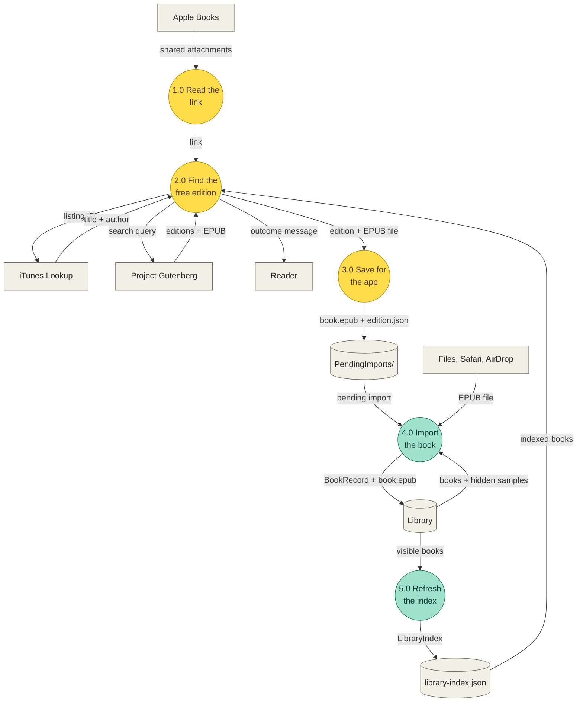
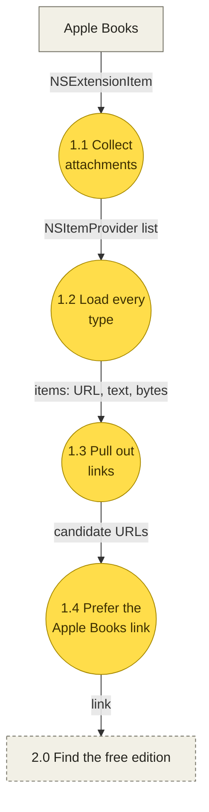
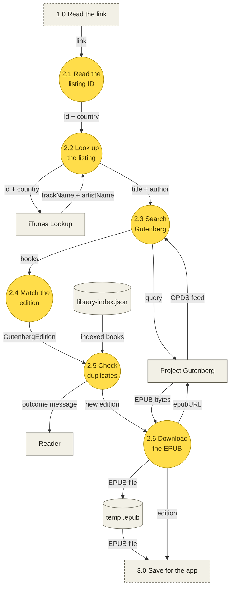
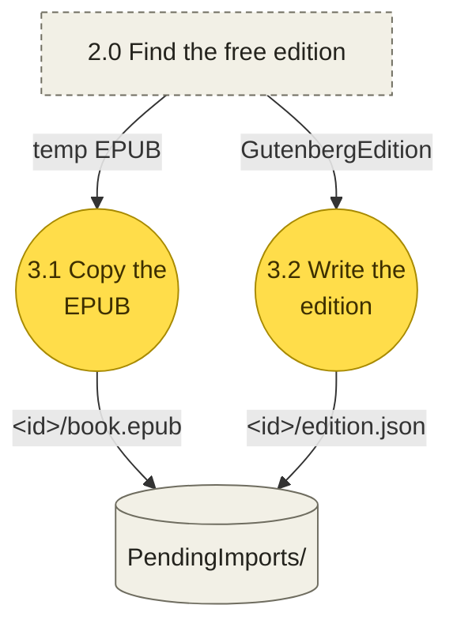
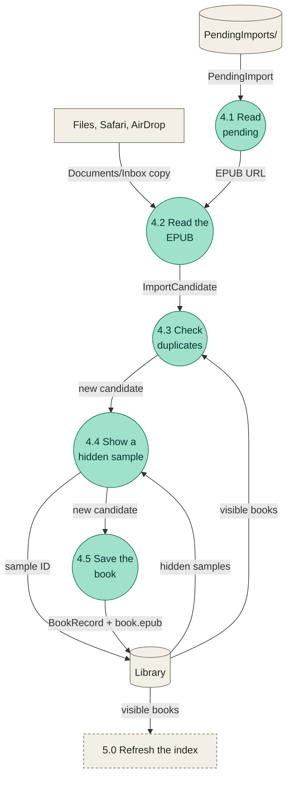
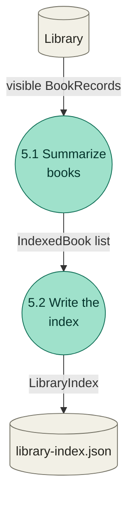

# Share import data flow (DFD)

How a book moves from Apple Books' Share Book into iRead's library: Level 1 (five processes), then Level 2 (the steps inside each one), each step linked to the code that does it. For the folders and layers, see [ARCHITECTURE.md](ARCHITECTURE.md).

- [Notation](#notation)
- [Level 1: five processes](#level-1-five-processes)
- [1. Read the link](#1-read-the-link)
- [2. Find the free edition](#2-find-the-free-edition)
- [3. Save for the app](#3-save-for-the-app)
- [4. Import the book](#4-import-the-book)
- [5. Refresh the index](#5-refresh-the-index)
- [Example: Dream Psychology](#example-dream-psychology)
- [Data dictionary](#data-dictionary)

## Notation

A DFD answers one question: what data moves where, and which process changes it.

| Shape | Meaning | Here |
|---|---|---|
| Box | External entity, outside iRead | Apple Books, iTunes Lookup, Project Gutenberg, the reader |
| Circle | Process that changes data, named with a verb | 2.0 Find the free edition |
| Cylinder | Data store | `PendingImports/`, `library-index.json`, the library |
| Arrow | Data flow, named with a noun | `GutenbergEdition` |
| Dashed box | A process from another diagram, shown for context | |

Yellow processes run in the Share extension (target `iReadShare`), while Apple Books is still open. Green ones run in the app (target `iRead`), the next time it opens. The two never call each other: they only share the App Group folder (`group.com.aftrhours.reader`, see [`AppGroup.swift`](../Shared/AppGroup.swift)).

Three rules:

1. Every process has an input and an output.
2. Data passes through a process. No arrow goes straight from entity to entity, entity to store, or store to store.
3. A DFD is not a flowchart: no branches or loops. An arrow means data *can* flow there, not that it always does. Where a share stops is listed in each step's "Stops as" column.

## Level 1: five processes



| Process | Question it answers | In | Out | Runs |
|---|---|---|---|---|
| 1. Read the link | Which Apple Books listing was shared? | `NSItemProvider` attachments | `URL?` | Once per share, in the extension |
| 2. Find the free edition | Is this book on Project Gutenberg, and new to the library? | link, `LibraryIndex` | `ShareOutcome` (edition + temp EPUB, or why not) | Once per share, in the extension, 30 s at most |
| 3. Save for the app | What does the app pick up later? | `GutenbergEdition`, temp EPUB | `PendingImport` | When the reader taps Send |
| 4. Import the book | Is it new, and where does it go? | `PendingImport` or an opened EPUB | `BookRecord` in the library | Each time the app becomes active, and per opened file |
| 5. Refresh the index | What will the extension check duplicates against? | visible books | `LibraryIndex` | After every import or removal |

Processes 1 to 3 never see the library: an extension can't read the app's own folder. `library-index.json` is the app's summary of it, written by process 5 and read by process 2. A book that is still waiting in `PendingImports/` is not in that index yet.

The extension starts in `ShareViewController.viewDidLoad` ([`ShareViewController.swift`](../ShareExtension/ShareViewController.swift)). The app side starts in `LibView`'s `scenePhase` change ([`LibView.swift`](../App/Library/Views/LibView.swift)), which calls `LibVM.appBecameActive` ([`LibVM.swift`](../App/Library/VM/LibVM.swift)).

## 1. Read the link

Runs once, before the sheet shows anything. Code: [`AppleBooksLink+Providers.swift`](../Shared/Import/Rules/AppleBooksLink+Providers.swift).



| Step | What happens | Code | Stops as |
|---|---|---|---|
| 1.1 | Every attachment of every shared item | `ShareViewController.sharedProviders` | |
| 1.2 | Load each attachment in each type it offers (Apple Books' own attachments aren't documented) | `AppleBooksLink.find(in:)` | |
| 1.3 | A URL as is; plain text, styled text or bytes read as a URL, else the first link in the text (`NSDataDetector`) | `AppleBooksLink.links(in:)`, `firstURL(in:)` | |
| 1.4 | The first link 2.1 can read, else the first web link, else any link | `AppleBooksLink.find(in:)` | No link at all: "Only Apple Books links…" |

Apple Books sends one `public.url` attachment, for example `https://books.apple.com/id/book/dream-psychology/id395687522P`. The letter after the ID is Apple's, and 2.1 ignores it.

## 2. Find the free edition

Runs once per share, from `ShareVM.onAppear` ([`ShareVM.swift`](../Shared/Import/VM/ShareVM.swift)), which calls `ShareCtrl.resolve` ([`ShareCtrl.swift`](../Shared/Import/Ctrl/ShareCtrl.swift)). The sheet shows "Finding this book…" until it ends.



| Step | What happens | Code | Stops as |
|---|---|---|---|
| 2.1 | Host must be `apple.com` or `*.apple.com`. The ID is the digits right after "id" in a path part (or an `id` query item); the country is a two-letter first path part, else "us" | `AppleBooksLink.listing(in:)` | `.unsupportedLink` |
| 2.2 | `itunes.apple.com/lookup?id=…&country=…` gives the title and author | `BookLookupSvcURLSession.listing`, `decodeListing` | No listing: `.notFound(title: nil)`; no answer: `.unreachable` |
| 2.3 | Gutenberg's own search, `gutenberg.org/ebooks/search.opds/?query=`: first the plain title and the author's last name, then the title alone if that matches nothing. Book entries become `GutendexBook`s; entries that list authors or subjects are skipped | `ShareCtrl.edition(for:)`, `EditionMatcher.searchQuery`, `titleQuery`, `BookLookupSvcURLSession.gutenbergBooks`, `decodeOPDS`, `GutenbergNumber.opdsEntry` | No answer: `.unreachable` |
| 2.4 | The first book with an EPUB whose title matches. After the title + last name search only the title is checked (Gutenberg already matched "Sun Tzu" to "Sunzi"); after the title-only search the author is checked too. The author shown is Apple's | `EditionMatcher.bestMatch`, `titlesMatch`, `authorsMatch`, `ShareCtrl.named` | `.notFound(title:)` |
| 2.5 | Same Gutenberg number, or matching title and author, as a book in the index. The text fingerprint can't help here: the EPUB isn't parsed in the extension | `DuplicateRules.match`, `LibraryIndexRepo.load` | `.alreadyInLibrary(title:)` |
| 2.6 | Download `https://www.gutenberg.org/ebooks/<number>.epub3.images` to a temp `.epub` | `DownloadSvcURLSession.download` | Over 100 MB: `.tooLarge`; no answer: `.unreachable` |

Knobs: `ShareCtrlKnobs.timeout` (30 s for 2.1 to 2.6 together; past it, `.unreachable`), `ShareCtrlKnobs.maxBytes` (100 MB), and a 30 s timeout on each request.

What the reader sees for each outcome is `ShareVM.message(for:)`:

| `ShareOutcome` | Sheet | Send |
|---|---|---|
| `.found` | Title, author, "Free Project Gutenberg edition. Apple Books doesn’t share its own files." | On |
| `.unsupportedLink` | "Only Apple Books links can be shared to iRead for now." | Off |
| `.notFound` | "“X” isn’t available as a free Project Gutenberg book, so it can’t be opened in iRead." | Off |
| `.alreadyInLibrary` | "“X” is already in your iRead library." | Off |
| `.unreachable` | "iRead couldn’t reach Project Gutenberg. Try again later." | Off |
| `.tooLarge` | "This book is larger than 100 MB." | Off |

## 3. Save for the app

Runs when the reader taps Send. The sheet then closes and the reader stays in Apple Books. Code: `ShareVM.sendTapped`, `ShareCtrl.send`, [`PendingImportRepo.swift`](../Shared/Import/Repo/PendingImportRepo.swift).



| Step | What happens | Code | Stops as |
|---|---|---|---|
| 3.1 | Copy the temp EPUB to `PendingImports/<new UUID>/book.epub` in the App Group | `PendingImportRepo.add(epubAt:edition:)` | "iRead couldn’t save this book. Try again." |
| 3.2 | Write `edition.json` last, so a half-written folder has no edition and 4.1 skips it | `PendingImportRepo.add(epubAt:edition:)` | Same |

Cancel writes nothing and deletes the temp EPUB (`ShareVM.cancelTapped`).

## 4. Import the book

Runs each time the app becomes active (`LibView` `scenePhase` → `LibVM.appBecameActive`), once for each EPUB opened with iRead (`iReadApp` `.onOpenURL` → `LibVM.fileOpened`), and for each file picked in the library (`LibVM.importFiles`). All three go through `LibVM.oneAtATime`, so two imports never run at once. Code: [`ImportCtrl.swift`](../App/Library/Ctrl/ImportCtrl.swift) and [`LibRepo.swift`](../App/Library/Repo/LibRepo.swift).



| Step | What happens | Code | Stops as |
|---|---|---|---|
| 4.1 | Every folder in `PendingImports/` with both files. Each one is removed after 4.2 to 4.5, whatever happened | `ImportCtrl.importPending`, `PendingImportRepo.all`, `remove` | |
| 4.2 | Title, author and `dc:identifier` (for the Gutenberg number), then a full parse for the text fingerprint | `LibRepo.candidate(for:)`, `EPUBParseSvc.metadata`, `GutenbergNumber.from(identifiers:)` | Unreadable EPUB |
| 4.3 | The same rule as 2.5, against the books the library shows now | `ImportCtrl.importFile(from:)`, `DuplicateRules.match`, `LibRepo.fetchBooks` | `ImportError.alreadyInLibrary` |
| 4.4 | The same book as a sample the reader removed: show the sample again instead of copying | `LibRepo.hiddenSamples`, `unhideSample` | |
| 4.5 | Copy the EPUB to `Books/<UUID>/book.epub` and add a `BookRecord` to `Books/library.json` | `LibRepo.importBook(from:as:)` | |

A shared book that stops here is only logged (`.info`, category `storage`): the reader left the sheet long ago. An opened or picked file that stops here shows its message in the library's alert. iOS's copy in `Documents/Inbox` is deleted either way.

## 5. Refresh the index

Runs after 4 (pending books and opened files), after the file picker imports, and after a book is removed. Code: `ImportCtrl.refreshIndex`, [`LibraryIndexRepo.swift`](../Shared/Import/Repo/LibraryIndexRepo.swift).



| Step | What happens | Code |
|---|---|---|
| 5.1 | Each visible book (samples not hidden, then imported books) as its title and `BookIdentity` | `LibRepo.fetchBooks`, `BookRecord.identity` |
| 5.2 | Replace `library-index.json` in the App Group | `LibraryIndexRepo.save` |

Until the app has opened once there is no index, so 2.5 finds no duplicates; 4.3 still does.

## Example: Dream Psychology

A real share, run on 2026-11-08. Times are from a Mac on Wi-Fi.

| Step | Data |
|---|---|
| 1.4 | `https://books.apple.com/id/book/dream-psychology/id395687522P` |
| 2.1 | id `395687522`, country `id` |
| 2.2 | "Dream Psychology", "Sigmund Freud" |
| 2.3 | query `dream psychology freud`; first entry `https://www.gutenberg.org/ebooks/15489.opds` |
| 2.4 | 15489, "Dream Psychology: Psychoanalysis for Beginners" (title starts with the Apple title) |
| 2.5 | Not in the index |
| 2.6 | 205,990 bytes; 3.3 s from 2.1 to here |

`PendingImports/<UUID>/edition.json` after Send:

```json
{
  "number": 15489,
  "title": "Dream Psychology: Psychoanalysis for Beginners",
  "author": "Sigmund Freud",
  "epubURL": "https://www.gutenberg.org/ebooks/15489.epub3.images"
}
```

One entry in `library-index.json` after the app imports it. Step 4.2 parsed the whole book, so it has a `fingerprint` (shortened here); bundled samples have none until they are read once:

```json
{
  "title": "Dream Psychology: Psychoanalysis for Beginners",
  "identity": {
    "gutenbergNumber": 15489,
    "title": "Dream Psychology: Psychoanalysis for Beginners",
    "author": "Sigmund Freud",
    "fingerprint": "…"
  }
}
```

*The Art of War* (`id395534623`) takes 1.9 s. Gutenberg lists its author as "active 6th century B.C. Sunzi", so 2.4 checks only the title, and the sheet shows Apple's "Sun Tzu".

## Data dictionary

The labels on the arrows describe the data. This table ties them to Swift types.

| Label | Swift | What it holds | Defined in |
|---|---|---|---|
| shared attachments | `NSExtensionItem`, `NSItemProvider` | What Apple Books hands the extension | UIKit / Foundation |
| link | `URL` | The Apple Books store link | |
| id + country | `(id: String, country: String)` | The listing ID and store country | `Shared/Import/Rules/AppleBooksLink.swift` |
| title + author | `(title: String, author: String)` | Apple's listing | `Shared/Import/Svc/BookLookupSvc.swift` |
| books | `GutendexBook` | Gutenberg number, title, authors, EPUB address | `Shared/Import/Models/GutendexBook.swift` |
| edition | `GutenbergEdition` | Number, title, author, EPUB address. `Codable`: it is `edition.json` | `Shared/Import/Models/GutenbergEdition.swift` |
| outcome | `ShareOutcome` | Found (edition + temp file), or why not | `Shared/Import/Ctrl/ShareCtrl.swift` |
| pending import | `PendingImport` | Folder ID, EPUB URL, edition | `Shared/Import/Repo/PendingImportRepo.swift` |
| indexed books | `LibraryIndex`, `IndexedBook` | Title and identity of each visible book | `Shared/Import/Models/LibraryIndex.swift` |
| identity | `BookIdentity` | Gutenberg number, title, author, fingerprint | `Shared/Import/Models/BookIdentity.swift` |
| ImportCandidate | `ImportCandidate` | Title, author, identity of an EPUB about to be imported | `App/Library/Models/ImportCandidate.swift` |
| BookRecord | `BookRecord` | One library book, with `gutenbergNumber` and `fingerprint` | `App/Book/Models/BookRecord.swift` |
| errors | `ImportError` | `unreachable`, `tooLarge`, `alreadyInLibrary(title:)` | `Shared/Import/Models/ImportError.swift` |
