# iRead diagrams

Author: Shanon Giuly Istanto · Updated 2026-11-06

Every diagram is Mermaid. GitHub draws them on this page. To edit one in Miro, copy its file from `docs/diagrams/` and paste it into Diagram → Build with code.

There is no login screen: the reader's iCloud account (shown in the reader menu) is the only account the app uses.

## 1. Use cases

Who uses the app and what they can do. Readers use both screens; developers only read shared ratings.

File: `docs/diagrams/01-use-cases.mmd`

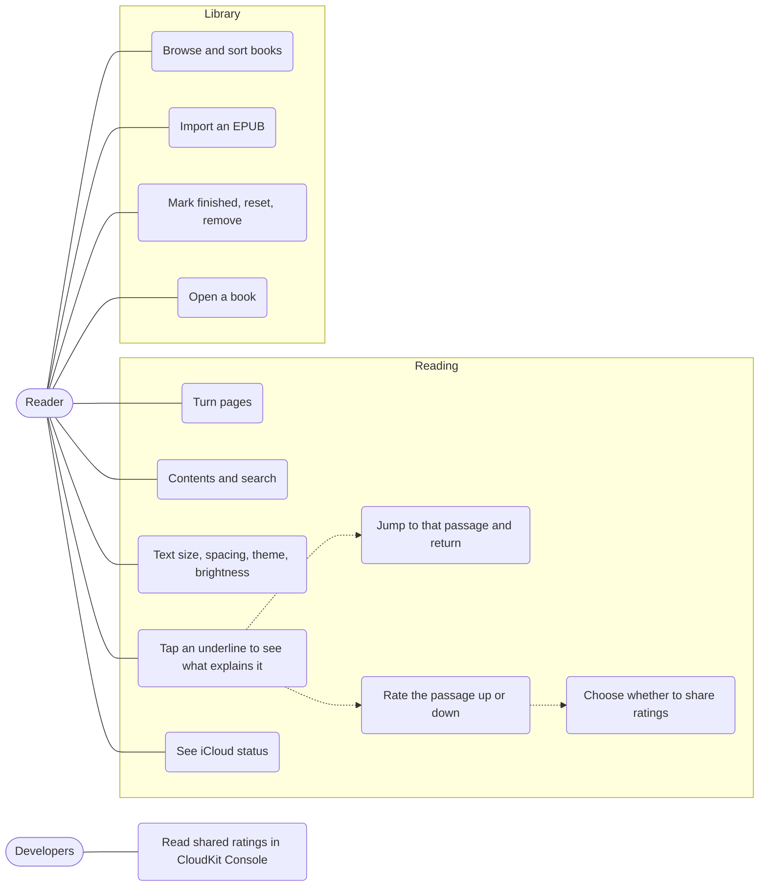

## 2. Architecture

One big diagram of every type has too many crossing lines, so it's split: an overview of the features, then one diagram per feature. In each, a layer only calls the layer below it. Dashed lines are calls into another feature's types. `AppContainer` builds everything; pure Rules (sorting, search, progress maths, `BookFingerprint`) are left out.

### 2a. Features

Which part of the app may use which. No cycles.

File: `docs/diagrams/02a-architecture-overview.mmd`

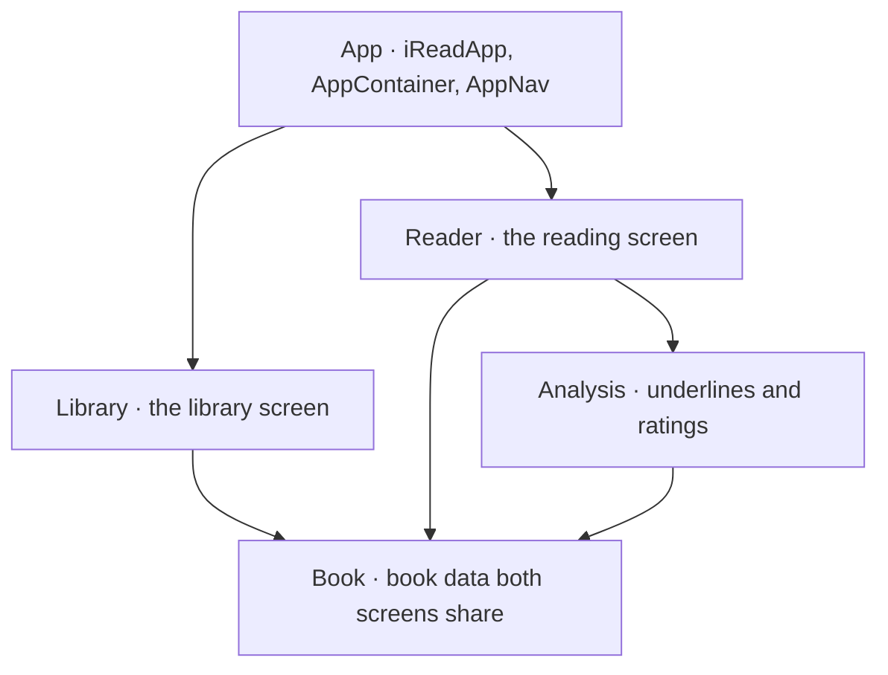

### 2b. Library

File: `docs/diagrams/02b-architecture-library.mmd`

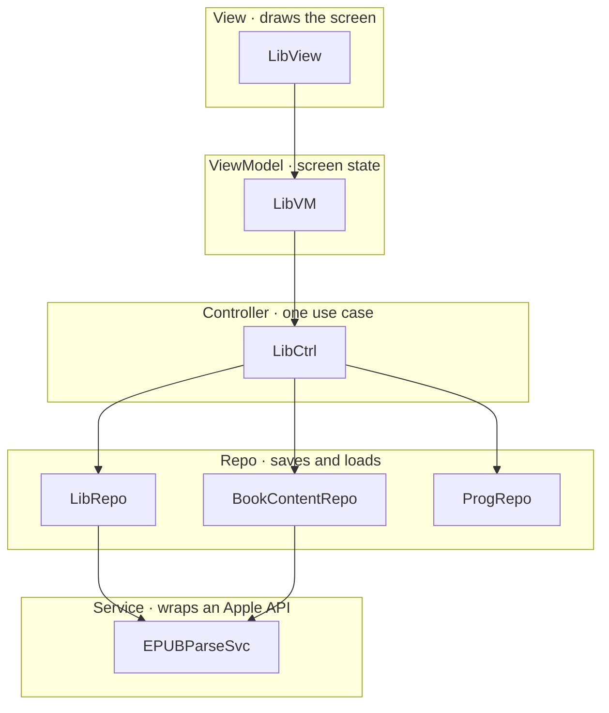

### 2c. Reader

Repos and Services sit on one row, because a Controller calls both directly.

File: `docs/diagrams/02c-architecture-reader.mmd`

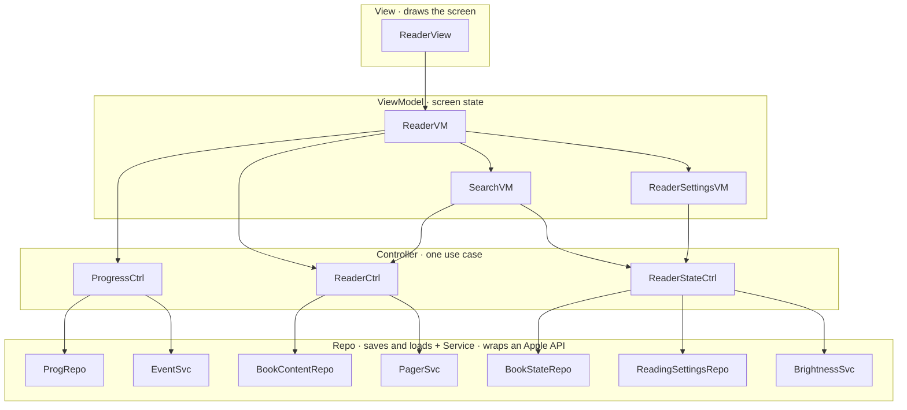

### 2d. Underlines and ratings

File: `docs/diagrams/02d-architecture-underlines.mmd`

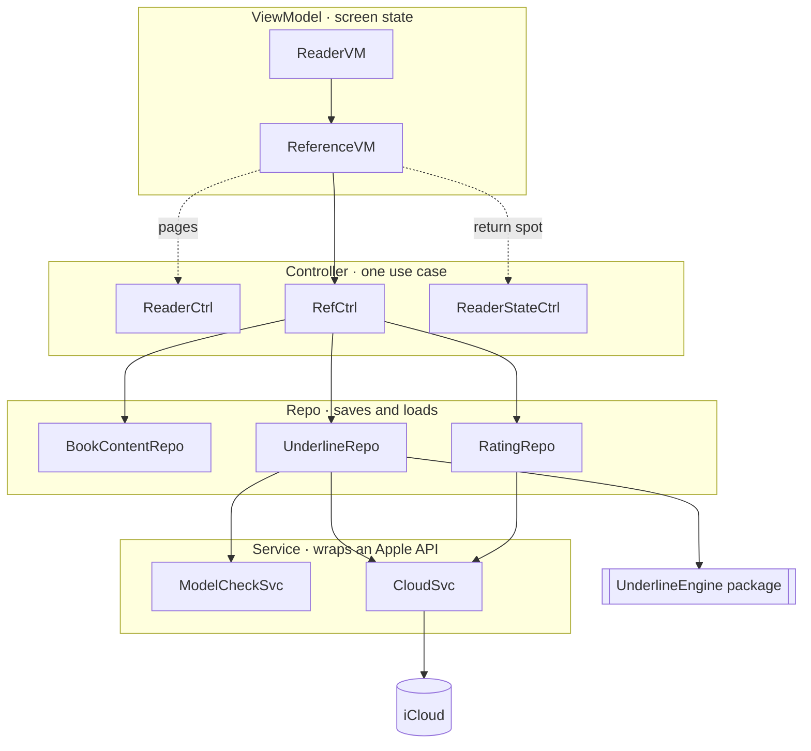

## 3. Data model (DMD)

The app's data and how it relates. A book has one record (library) and one parsed content (reader). `BookContent.fingerprint` names a book by its text, so underlines and ratings match on every device. `ReadingSettings` is one record for the whole app.

File: `docs/diagrams/03-data-model.mmd`

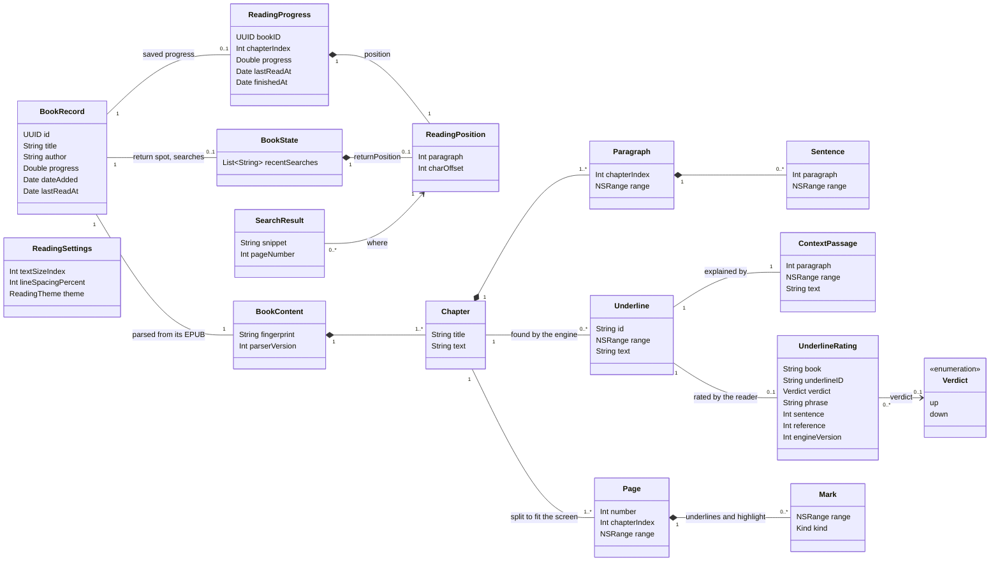

## 4. UnderlineEngine input and output

What iRead sends the engine (one chapter) and what it gets back (one result per paragraph). Indexes are global; ranges are UTF-16 inside a paragraph.

File: `docs/diagrams/04-underline-engine-data.mmd`

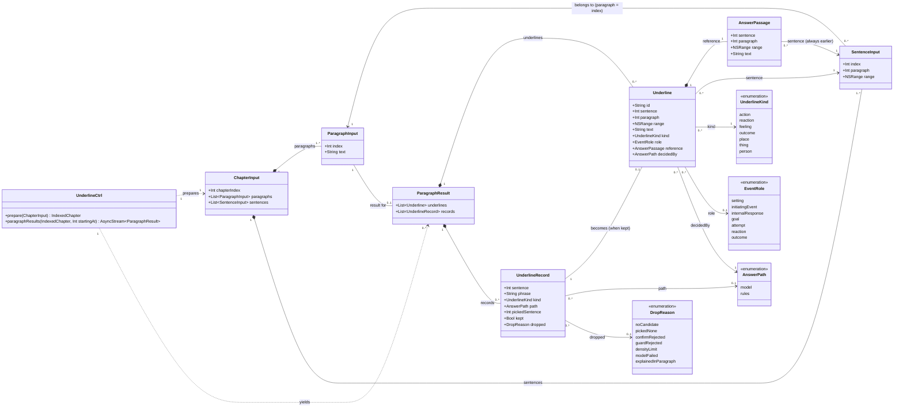

## 5. Where data lives

Everything is saved on the phone first. Underlines also go to the reader's own iCloud; ratings go to the developers only if the reader shares.

File: `docs/diagrams/05-where-data-lives.mmd`

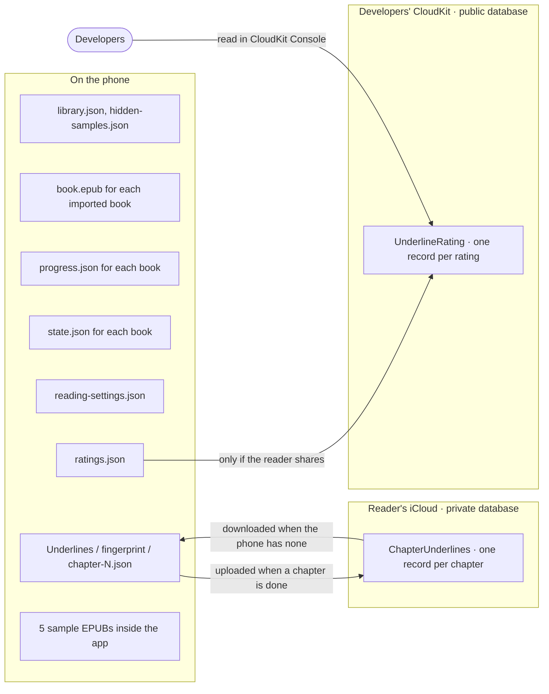

## 6. Data flow, level 0 (DFD)

The whole app as one process, and what goes in and out.

File: `docs/diagrams/06-dfd-level-0.mmd`

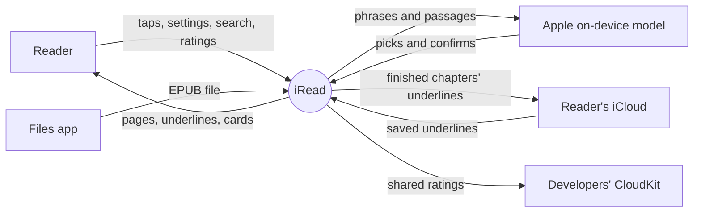

## 7. Data flow, level 1 (DFD)

Six processes and the files they read and write.

File: `docs/diagrams/07-dfd-level-1.mmd`

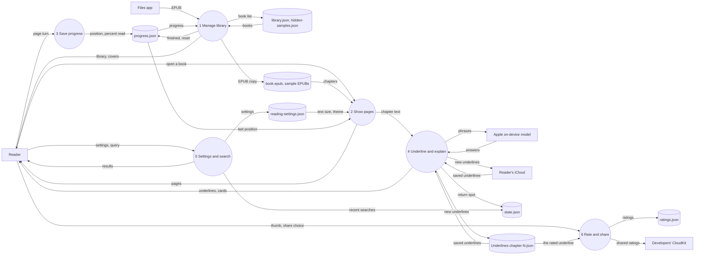

## 8. Sequence: open the app

The library is the sample books plus imported books, each with its saved progress.

File: `docs/diagrams/08-sequence-open-app.mmd`

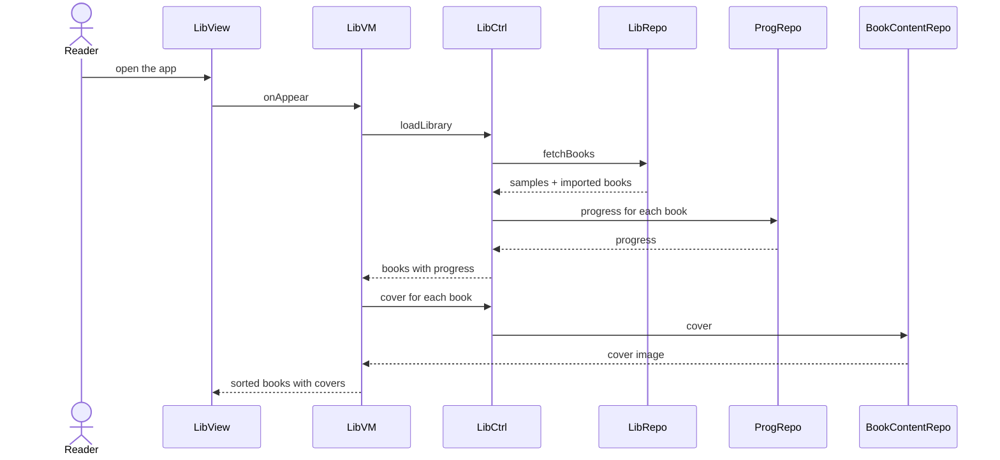

## 9. Sequence: read a book

Opening restores the last position. Every page turn saves progress; Back saves once more and stops the underlining.

File: `docs/diagrams/09-sequence-read-a-book.mmd`

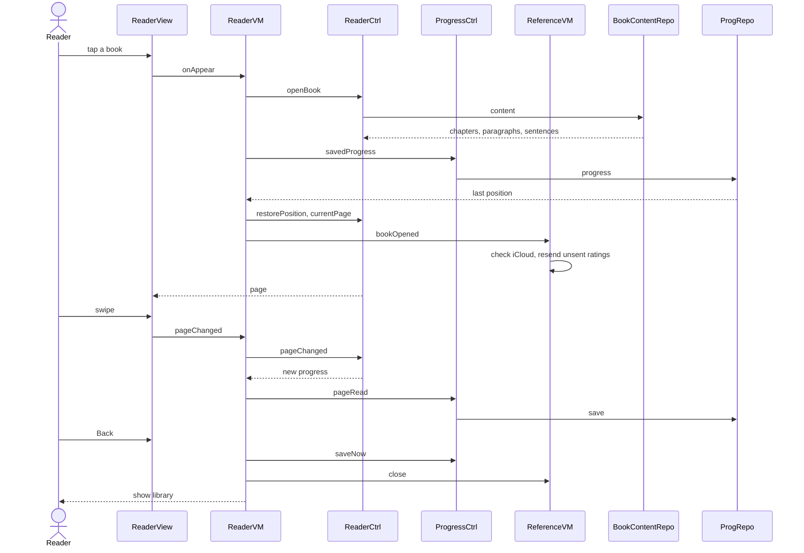

## 10. Sequence: underlines

A chapter is underlined once: from the phone first, then iCloud, and only then the engine.

File: `docs/diagrams/10-sequence-underlines.mmd`

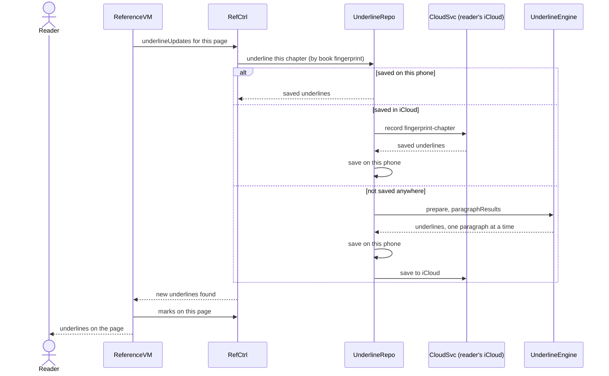

## 11. Sequence: rate a passage

The first rating asks whether to share. Ratings always stay on the phone; shared ones also go to the developers.

File: `docs/diagrams/11-sequence-rate-a-passage.mmd`

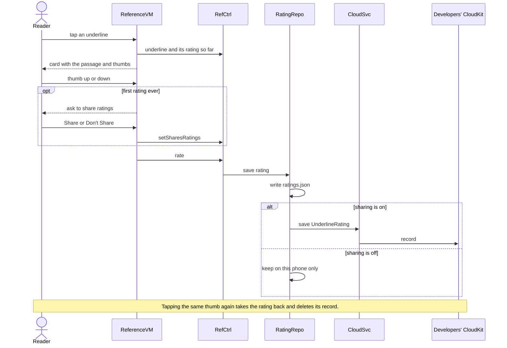

## 12. Sequence: jump and return

Jumping saves where the reader was, so Return to Reading can bring them back.

File: `docs/diagrams/12-sequence-jump-and-return.mmd`

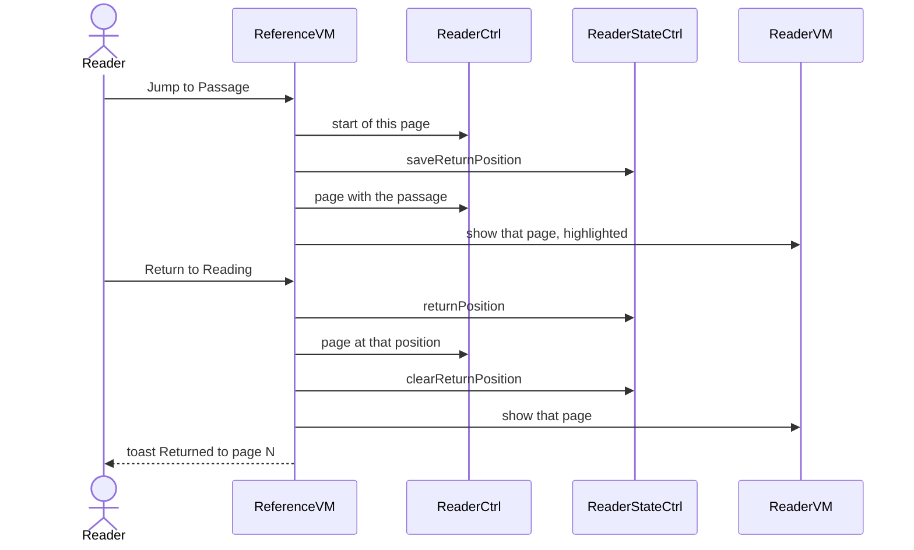

## 13. Screens (state)

Two screens. Everything else is a sheet, card or prompt over the reader.

File: `docs/diagrams/13-state-screens.mmd`

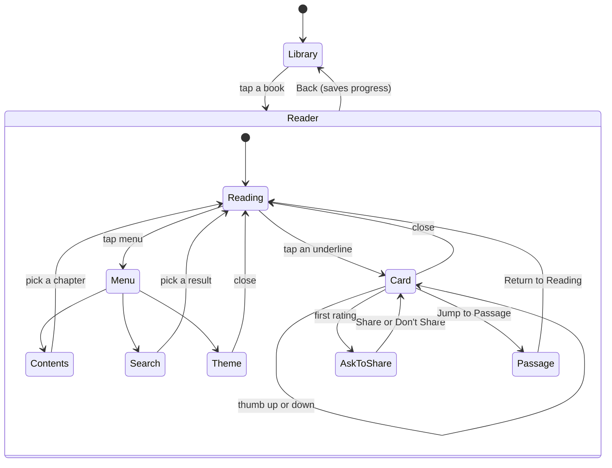
